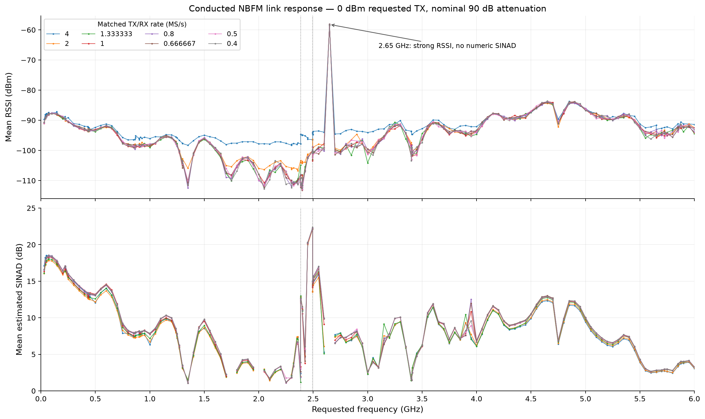
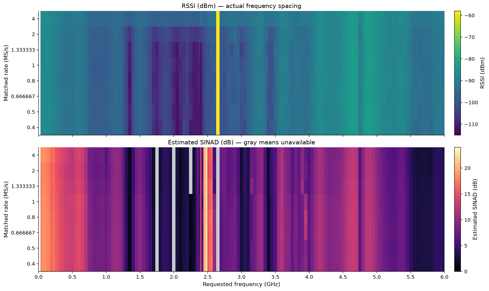
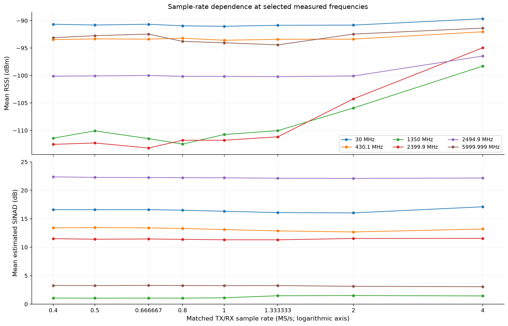
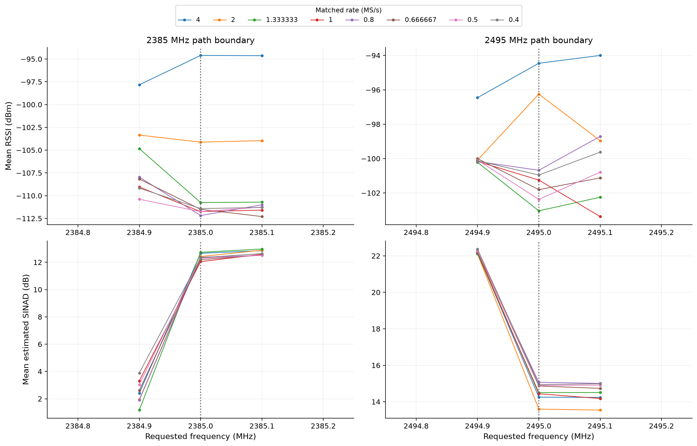

# Pi Zero / CaribouLite board #1 frequency and sample-rate sweep

**21 November 2026 · 15:16–18:48 Europe/Brussels · 0 dBm requested TX · nominal 90 dB link attenuation**

## Findings

All **1,376 planned measurements** completed: 172 frequencies at eight matched TX/RX sample rates. Independent verification passed against 32,400 paired snapshots, including eight preflight measurements; the main matrix contains **32,211 paired snapshots**. Both backends stopped at completion, and the receiver command audit found no TX commands.

Frequency dominates the measured response. Among **165 frequencies** with fully valid SINAD at every rate, the median difference between the highest and lowest rate-specific SINAD is **0.65 dB**; the largest is **5.44 dB**. No single rate is uniformly best. The small median advantages of lower rates are descriptive and do not establish a causal rate improvement: the sweep ran each rate sequentially over approximately 3½ hours.

RSSI and recovered tone quality can disagree substantially. At **2.65 GHz**, mean RSSI is approximately **−58 dBm** across rates, yet the estimator reports no numeric SINAD. Around **2.4 GHz**, changing rate changes reported RSSI by up to approximately **18 dB**, while SINAD at nearby frequencies changes much less. Strong RSSI alone therefore does not establish a usable wanted signal.

## Measurement setup

| Item | Setting |
|---|---|
| TX | Original board on `pi0a-trixie` (`192.168.6.37`) |
| RX | Reconstructed board #1 on `pi0b-trixie` (`192.168.6.69`), RX only |
| RF path | RF24/HiF, user-confirmed nominal 90 dB attenuation between boards |
| TX power | 0 dBm requested at every point; no calibrated RF power measurement |
| Modulation | NBFM, 1 kHz sine, amplitude 0.4, deviation setting 2500 Hz |
| Frequency grid | 172 points; 50 MHz base grid plus band anchors and path-boundary points |
| Frequency endpoints | 30 MHz to 5,999.999 MHz; exactly 6 GHz is outside the supported exclusive upper limit |
| Rates | 4, 2, 1.333333, 1, 0.8, 0.666667, 0.5 and 0.4 MS/s; TX and RX changed together |
| Acquisition | 2 s settling, then 5 s measurement; fresh per-host sequences and monotonic timestamps |
| RX setup | Both squelches disabled; LED1 held low with LED0 preserved |
| SINAD | Backend 1 kHz NBFM estimate over 300–3000 Hz; no numeric estimate retained as missing |

The fractional native rates are 4 MHz divided by 3 and 6; their integer command labels are rounded. The RX analog bandwidth remains 160 kHz and TX analog bandwidth 80 kHz, while the digital cutoff changes with sample rate (500 kHz at 4 MS/s down to 50 kHz at 0.4 MS/s). Thus the experiment varies a complete rate profile on both boards, rather than isolating one receiver parameter.

These measurements characterize the **complete transmitter–attenuator–receiver link**. Requested TX power and nominal attenuation do not establish actual input power at every frequency. No receiver sensitivity threshold, noise figure, calibrated SINAD instrument comparison, or other-board comparison was measured in this run.

## RSSI and SINAD versus frequency



[Vector plot](analysis/frequency-overview.svg). Points are measured frequency settings; connecting lines guide the eye and do not imply continuous-frequency coverage. Missing SINAD values interrupt the lines. Dotted vertical lines mark 2385 and 2495 MHz RF path boundaries.

At 1 MS/s, representative point means are:

| Frequency MHz | RSSI dBm | Estimated SINAD dB |
|---:|---:|---:|
| 30.000 | -91.04 | 16.32 |
| 430.100 | -93.58 | 13.10 |
| 1000.000 | -98.58 | 7.74 |
| 1350.000 | -110.75 | 1.11 |
| 2384.900 | -109.05 | 3.31 |
| 2385.000 | -111.75 | 12.04 |
| 2399.900 | -111.79 | 11.31 |
| 2400.000 | -108.17 | Unavailable |
| 2494.900 | -100.17 | 22.20 |
| 2495.000 | -101.25 | 14.44 |
| 2650.000 | -58.25 | Unavailable |
| 4650.000 | -83.75 | 12.87 |
| 5999.999 | -94.04 | 3.24 |

The best point mean in the full matrix is **22.38 dB SINAD at 2494.9 MHz and 0.4 MS/s**. At 1 MS/s the same frequency gives 22.20 dB. At the high endpoint, all rates yield only about 3.1–3.3 dB estimated SINAD. These are link observations; the data do not identify whether TX response, RX response, local interference, conversion artifacts, or the RF path dominates each feature.

## Frequency and rate maps



[Vector plot](analysis/frequency-rate-heatmaps.svg). Rows are discrete rate settings, ordered from 4 down to 0.4 MS/s. Cell boundaries fall halfway between neighboring measured frequencies on the actual nonuniform frequency axis; colors are not interpolated. Gray SINAD cells mean unavailable estimates. Very closely spaced boundary measurements are easier to see in the zoom plots below.

## Sample-rate comparison

| Matched rate MS/s | Numeric SINAD / 172 | Median RSSI dBm | Median numeric SINAD dB | Points ≥12 dB SINAD | Median paired SINAD Δ vs 1 MS/s dB |
|---:|---:|---:|---:|---:|---:|
| 4 | 167 | -92.60 | 7.89 | 48 | -0.23 |
| 2 | 167 | -94.32 | 7.83 | 48 | -0.34 |
| 1.333333 | 167 | -94.38 | 8.05 | 50 | -0.16 |
| 1 | 168 | -94.33 | 8.35 | 50 | +0.00 |
| 0.8 | 168 | -93.98 | 8.49 | 51 | +0.08 |
| 0.666667 | 168 | -94.12 | 8.51 | 50 | +0.11 |
| 0.5 | 168 | -94.15 | 8.49 | 50 | +0.06 |
| 0.4 | 168 | -94.23 | 8.50 | 50 | +0.09 |

Medians weight each measured frequency equally, so clustered band anchors carry more weight than a uniform sweep would. Numeric-SINAD medians exclude missing points. Paired differences use only frequencies with fully valid windows in both compared rates; sample counts are in [rate-summary.csv](analysis/rate-summary.csv). The ≥12 dB column is a descriptive count, not a measured sensitivity threshold or pass/fail specification.



[Vector plot](analysis/rate-profiles.svg). Selected frequency profiles show that RSSI can change greatly with rate without a comparable change in recovered SINAD. At 2399.9 MHz, mean RSSI spans −94.96 to −113.21 dBm (18.25 dB), while the rate-specific SINAD means span only 11.30–11.55 dB. This pattern warrants a targeted RSSI/register/AGC investigation; it is not evidence that received wanted-signal power changed by 18 dB.

## RF path boundaries



[Vector plot](analysis/path-boundary-zooms.svg). At 1 MS/s, SINAD increases from 3.31 dB at 2384.9 MHz to 12.04 dB at 2385 MHz, and decreases from 22.20 dB at 2494.9 MHz to 14.44 dB at 2495 MHz. These steps align with the native-modem/mixer path boundaries. The alignment supports investigating path-dependent behavior, but this combined-link sweep cannot assign the change to the TX or RX board.

## Missing and partially valid SINAD

Numeric estimates are available at **1,341 / 1,376 points**. **35 points have no numeric estimate**, and three additional points have partially valid windows. Missing values are not zero SINAD and are not proof of absent RF.

| Frequency MHz | Rates with no numeric SINAD (MS/s) |
|---:|---|
| 1750 | All eight rates |
| 2000 | All eight rates |
| 2250 | 4, 2, 1.333333 |
| 2400 | All eight rates |
| 2650 | All eight rates |

| Frequency MHz | Rate MS/s | Valid snapshots / total |
|---:|---:|---:|
| 2384.9 | 1.333333 | 22 / 24 |
| 2250 | 1 | 18 / 24 |
| 1350 | 0.4 | 22 / 24 |

The unavailable estimates recur at a small number of frequency settings, suggesting frequency-specific effects worth repeating. A source of interference, a conversion spur, tuning behavior, or inadequate wanted-tone quality are hypotheses; none is established by these data. In particular, the strong 2.65 GHz RSSI reading should be checked with TX off and with a frequency offset before interpreting it as the desired signal.

## Transport integrity and verification

All 1,376 matrix measurement windows have zero increases or resets in the selected RX/TX transport counters. This does **not** mean every counter was zero throughout startup, tuning, and settling. The archived histories show:

- RX `alignment.invalid_frames`: peak cumulative count **25**, with **25 positive increments** across the full recorded history.
- TX `driver.underrun_periods`: peak **4**, with **18 positive increments** across the full recorded history; this counter resets across some operations.

Those increases occurred outside the retained matrix measurement windows. Nonzero counters inherited by later points are therefore distinct from new errors during measurement. The main matrix has no RX queue/audio drops, playback underruns/write errors, reader errors, alignment failures, TX writer errors, or TX queue drops in its recorded windows.

The existing verifier independently recomputed point counts and RSSI/SINAD means from raw snapshots, checked role identities and requested frequency/rate/power settings, audited receiver commands, and checked final backend release. It passed. This analysis additionally checks the full 172 × 8 matrix and reads both hosts’ archived status histories. The original 18 artifact checksums were verified before this report was created.

## Interpretation and next measurements

The Pi Zero pair sustained the planned acquisition at every supported rate without new transport errors in measurement windows. For this link and tone, choosing a rate alone does not resolve the large frequency-dependent SINAD variations. At 430.1 MHz, all eight preflight rates were usable and gave approximately 14.1–14.4 dB SINAD.

A useful follow-up would repeat the low-SINAD and missing-estimate frequencies with TX off/on and small frequency offsets, then repeat a few anchors while alternating rates rather than sweeping each rate in a separate time block. To isolate receiver behavior, hold TX rate fixed while varying RX rate; a separate controlled run can isolate TX rate. Calibrated frequency-dependent input power or a known signal generator would be needed for a receiver sensitivity claim. No additional transmission was performed for this analysis.

## Files and reproducibility

- [Point measurements CSV](results.csv) and [full point summaries](results.jsonl).
- [Original completion report](REPORT.txt), [verification](verification.json), and [test plan](plan.json).
- [Analysis summary JSON](analysis/analysis-summary.json) and [rate-summary CSV](analysis/rate-summary.csv).
- [Raw paired snapshots](paired-snapshots.jsonl.gz), [TX host archive](tx-host-artifacts.tar.gz), and [RX host archive](rx-host-artifacts.tar.gz).
- [Analysis source](analysis/analyze_sweep.py) and [analysis artifact checksums](analysis/SHA256SUMS).

Regenerate the report and PNG/SVG figures from the repository root:

```sh
python3 -m venv /tmp/cariboulite-sweep-analysis
/tmp/cariboulite-sweep-analysis/bin/pip install -r \
  docs/baselines/20261121-pi0-board1-frequency-rate-sweep/analysis/requirements.txt
MPLCONFIGDIR=/tmp/cariboulite-matplotlib \
/tmp/cariboulite-sweep-analysis/bin/python \
  docs/baselines/20261121-pi0-board1-frequency-rate-sweep/analysis/analyze_sweep.py \
  docs/baselines/20261121-pi0-board1-frequency-rate-sweep
```

This baseline retains the report, plots, acquisition and analysis sources, point results, and compressed raw evidence in Git. The original acquisition directory and analysis virtual environment remain under ignored `build/`. Acquisition sources preserve the original host addresses and paths and must be reviewed before reuse; running them can transmit RF.
