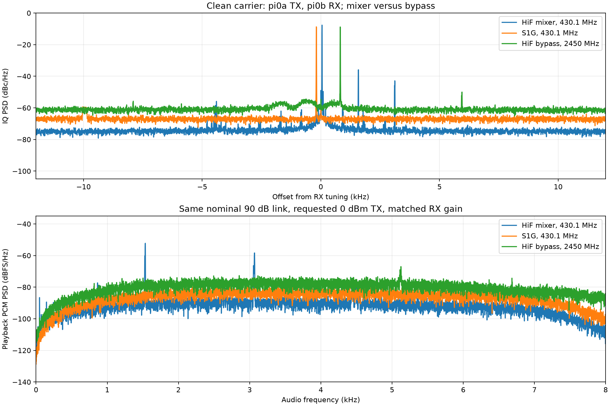

# HiF mixer-bypass whistle test at 2450 MHz

22 November 2026. The original strong approximately 1.5 kHz HiF whistle was
not reproduced at 2450 MHz with mixer bypass. However, bypass **does not remove
all narrow tones**: a weaker approximately 5.1–5.3 kHz component remains in IQ
and demodulated audio, alongside a higher broadband noise floor. The evidence
does not identify a faulty component or establish that all remaining features
have the same source as the original whistle.

## Configuration and route verification

- Operator connected the nominal 90 dB attenuated link to both HiF ports.
  TX was pi0a/original board, UUID `c132d0e7-d7dd-457a-b105-4a5cd97e7e80`;
  RX was pi0b/reconstructed board, UUID `d8810044-c444-46f4-a548-703412cbf971`.
- Both selected RF24 at requested 2450 MHz. The modem reported
  2449.999616 MHz at center tuning. Requested and reported TX power was 0 dBm.
  No absolute power or link attenuation calibration was performed.
- The existing full-board native-band path automatically selects bypass from
  2385 MHz up to, but excluding, 2495 MHz. A process-local interposer forwarded
  each frontend mode selection unchanged and read back the FPGA mode immediately
  afterward. All ten sessions (one TX, nine RX) selected and read back **mode 1,
  bypass**, with successful SPI calls. No conversion modes 2–5 were selected.
  See [route verification](route-verification.json) and `route_probe.c`.
- Readback verifies the internal frontend selection, not a physical pad level
  or mixer power-down. The current FPGA top-level mixer-enable pad override
  remains unchanged. Bypass routes around mixer conversion; it does not prove
  the mixer chip is electrically silent.
- The same nine cases as the [430.1 MHz HiF run](../20261122-pi0-whistle/README.md)
  and [S1G run](../20261122-pi0-whistle-s1g/README.md) were acquired: carrier,
  CTCSS-only with RX tone gate off/on, 1 kHz tone without/with CTCSS, RX tuning
  offsets of +5/-5 kHz, 2 MS/s RX, and no TX. TX stayed at 1 MS/s throughout.
- NBFM deviation was 2500 Hz; synthetic 1 kHz amplitude was 0.4. CTCSS cases
  used 88.5 Hz and 200 Hz TX deviation. CDCSS was off in every case. The
  microphone compressor does not process this synthetic source.
- Matched RX gain and `am=-7`, `usb=0`, `lsb=0` trims were retained. Noise/carrier
  squelch was bypassed, and playback used pi0b's Jabra USB device.
- Deployed source revision was `1514ab0`. An isolated pi0a TX binary permitted
  exactly zero synthetic tone amplitude; other code and DSP objects came from
  the deployed application. No installed binary, FPGA or driver was modified.
  No oscillator/SMI TX timing workaround was used.
- After three seconds settling, each case captured four seconds of decoded
  signed-int16 IQ and six seconds of accepted 48 kHz playback PCM. Captures were
  buffered in prefaulted RAM and saved at shutdown. Helpers had heartbeat and
  backend duration limits.

## Measurements

| Measurement | HiF mixer, 430.1 MHz | S1G, 430.1 MHz | HiF bypass, 2450 MHz |
| --- | ---: | ---: | ---: |
| Centered desired-carrier offset in IQ | +49.6 Hz | -190.7 Hz | +816.3 Hz |
| Clean-carrier audio power, 300–3000 Hz | -47.03 dBFS | -51.00 dBFS | -44.87 dBFS |
| Power in old whistle band, 1534.4 ±60 Hz | -47.64 dBFS | -64.45 dBFS | -57.80 dBFS |
| Live 1 kHz SINAD, CTCSS off | 19.112 dB | 20.722 dB | 15.189 dB |
| Live 1 kHz SINAD, CTCSS on | 18.867 dB | 20.378 dB | 14.927 dB |

There is no comparably prominent narrow 1.5 kHz line in the bypass carrier
capture. Its old-whistle-band power is 10.2 dB below the original capture,
including noise. This is not a residual-tone measurement or a general audio
quality improvement: bypass has more broadband noise, and its total voice-band
noise power is higher. Centered RX RSSI was approximately -106 dBm, versus
about -101 dBm on S1G and -92 dBm in the original HiF run. Received power and
SNR were not matched across these different RF paths/frequencies.

The additional approximately 5.2 kHz feature has the following IQ behavior:

| Case | Carrier in IQ | Tracked IQ line | Separation | Strongest playback peak |
| --- | ---: | ---: | ---: | ---: |
| Centered | +816.3 Hz | +5947.1 Hz | 5130.8 Hz | 5124.8 Hz |
| RX requested +5 kHz | +6355.3 Hz | +11570.0 Hz | 5214.7 Hz | 6632.8 Hz |
| RX requested -5 kHz | -3566.7 Hz | +1670.8 Hz | 5237.6 Hz | 5226.6 Hz |

Unlike the earlier receiver-relative HiF spur, this line moves with the desired
carrier. Its integrated power is approximately -36.1/-35.1/-35.3 dBc, using
±60 Hz around the line and ±80 Hz around the carrier. The tracking analysis
selects the strongest IQ bin 4.5–6 kHz above the carrier; it does not identify
every peak as the same physical mechanism. Sequential drift and different
IQ/playback capture windows limit exact frequency comparisons.

Centered and RX-minus cases show the corresponding approximately 5.2 kHz tone
in both the production discriminator and an independent float64 FM decoder.
In the RX-plus case the tracked IQ line is outside the nominal demodulator
channel, and another component dominates audio near 6.6 kHz; the table does not
pair that audio peak with the tracked line. Thus the bypass residual cannot
be assigned solely to playback, but its TX-versus-RX origin is not established.
No independent RSP2pro observation was collected in this run.

The 2 MS/s control also has other features, including audio near 1.19 and
6.84 kHz. A strong full-band IQ bin at +312.5 kHz lies outside the demodulated
channel. Desired-carrier selection in `analyze.py` is restricted to ±15 kHz;
the strongest full-band bin is retained separately in `summary.json`. IQ PSD
uses `detrend=False` to preserve DC. The no-TX capture is an open-squelch noise
control, not a silence recording.

All nine captures have their expected lengths and zero measured capture-window
deltas for RF/audio queue drops, playback underruns/errors, RX read errors,
TX writer errors, driver underruns and playback clipping. Original FPGA LED
state was restored. Both radios were stopped; an independent process scan
found no remaining radio owners.

## What this establishes

RF24 can operate without mixer conversion, and the original strong whistle is
not invariant across the tested RF24 configurations. Bypass still has weaker
tones already present in IQ, so bypass is not a complete cure for all artifacts.
The comparison changes frequency, modem tuning, frontend routing and received
power together. In particular, 430.1 MHz conversion uses a modem IF of 2495 MHz,
whereas this bypass run tunes the modem to 2450 MHz. The mixer alone therefore
has not been proved responsible or exonerated. A bypass point near the original
IF, such as 2494 MHz, and matched received power would be useful further controls.

## Evidence and reproduction

- [Clean-carrier audio](analysis/carrier.wav), [1 kHz audio](analysis/tone_1k.wav),
  [CTCSS-only audio](analysis/ctcss_only_rx_on.wav), without normalization.
- [Three-way comparison](analysis/channel-comparison.png),
  [IQ-line tracking](analysis/localization.png), [carrier detail](analysis/carrier.png),
  [all controls](analysis/comparison.png).
- [Summary](analysis/summary.json), [tracking metrics](analysis/localization.json),
  [health checks](analysis/health.json), [full statuses](measurements.json),
  [plan](plan.json), [route readback](route-verification.json),
  [shutdown check](shutdown-check.json), [original captures](captures.tar.gz),
  [checksums](SHA256SUMS).

Extract the capture archive into `build/whistle-bypass-analysis/data/`. Compile
`decode_iq.c` as described in the original HiF report, then run `analyze.py`,
`summarize.py`, `compare_channels.py` and `check_routes.py`. Comparison requires
the previous two datasets in their original build directories. Python package
versions are in `analysis/requirements.txt`. `run_measurements.py` operates real
hardware and is separate from offline analysis. For hardware reproduction,
compile `route_probe.c` as a shared object with `cc -shared -fPIC -O2 -Wall
-Wextra -Werror route_probe.c -ldl -o route_probe.so` in the helper's expected
`build/whistle-bypass/` location on both Pis; compile the capture tap on RX and
run `build_tx_probe.py` on TX, as in the preceding experiments.
