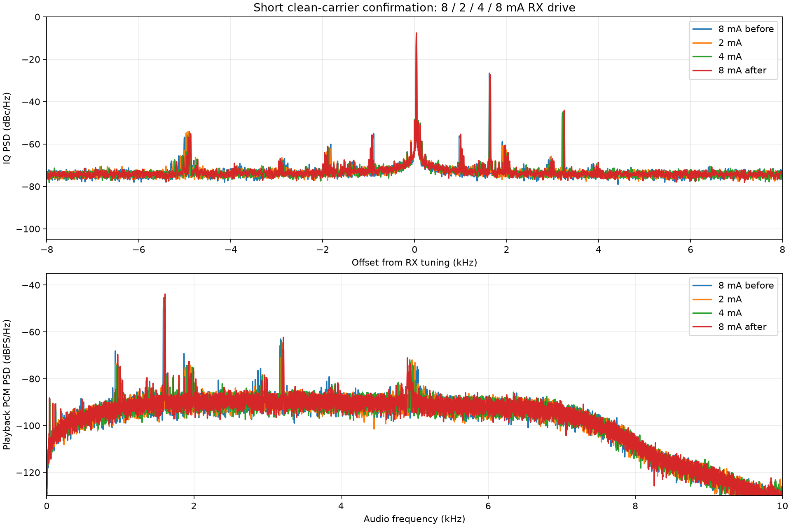
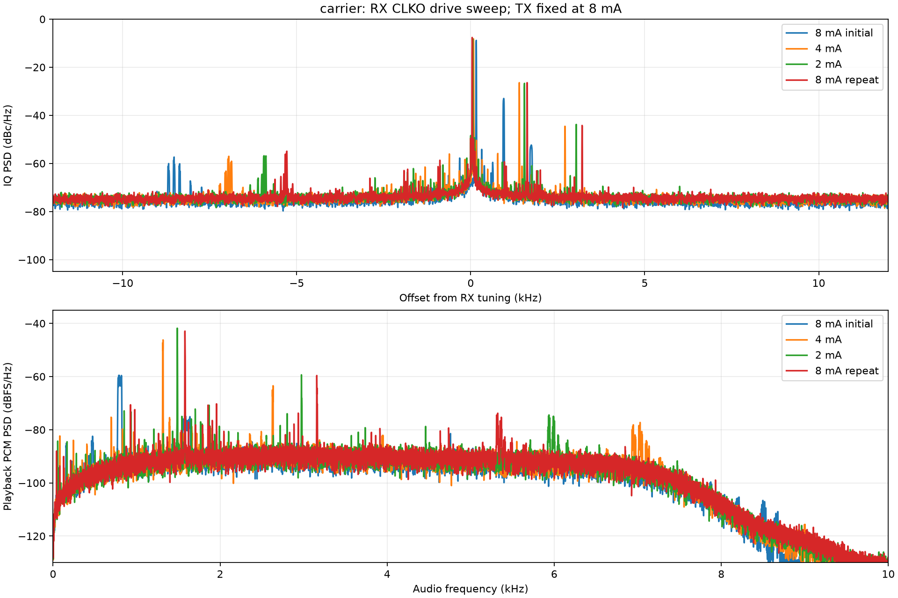

# HiF receiver reference-clock drive sweep

22 November 2026. Lowering the receiver's reference-clock drive from **8 mA to
4 or 2 mA did not meaningfully reduce the whistle** in this test. The short
reverse-order confirmation found the dominant IQ spur between **-18.25 and
-18.20 dBc** at all tested settings. Voice-band playback power varied by less
than 0.10 dB, and the whistle remained in both independent FM replay and actual
playback PCM. These small differences are not evidence of a drive improvement.

This tests the effect of the **drive-strength register**, not compliance of
the loaded reference waveform with the mixer's voltage specification. No scope
or reference-pin voltage measurement was made. The result does not establish
that the reference amplitude is correct, nor identify the interference source.

## Setup and controls

- TX: pi0a/original board, UUID `c132d0e7-d7dd-457a-b105-4a5cd97e7e80`.
- RX: pi0b/reconstructed board, UUID `d8810044-c444-46f4-a548-703412cbf971`.
- Operator's nominal 90 dB cable link remained on the HiF ports. Both selected
  RF24 at 430.100 MHz, with **mixer conversion active**. Requested/reported TX
  power was 0 dBm. Neither link attenuation nor absolute RF power was calibrated.
- The RF24 modem IF is nominally 2495 MHz in this conversion region. Receiver
  frontend readback was mode **2**, transmitter readback mode **4** when active.
  The no-TX cases correctly read back transmitter low-power mode 0.
- The receiver reference frequency remained **32 MHz**. Only receiver CLKO
  drive strength changed. Transmitter CLKO stayed at **8 mA** throughout.
- Main matrix: nine original whistle cases at each of **8 -> 4 -> 2 -> 8 mA**,
  36 captures in all. These include clean carrier; CTCSS-only with RX tone gate
  off/on; 1 kHz without/with CTCSS; receiver tuning offsets +5/-5 kHz; 2 MS/s RX;
  and an open-squelch no-transmitter control.
- A further four clean-carrier captures used **8 -> 2 -> 4 -> 8 mA**, in under
  a minute from the first capture's settling period to the last capture's end.
  This reversed the middle order and reduced the elapsed time between levels.
- TX rate was 1 MS/s throughout; RX was normally 1 MS/s. NBFM total deviation
  was 2500 Hz; 1 kHz tone amplitude was 0.4. CTCSS cases used 88.5 Hz and 200 Hz
  TX deviation. CDCSS was off. The microphone compressor does not process the
  synthetic source. Matched RX gain and `am=-7`, `usb=0`, `lsb=0` trims were retained.
- Noise/carrier squelch was bypassed, with CTCSS gating enabled only in its
  specified cases. Playback used the Jabra USB device on pi0b.
- After three seconds settling, each case captured four seconds of decoded
  int16 IQ and six seconds of accepted 48 kHz playback PCM. The taps buffered
  in prefaulted RAM and saved only after streaming stopped. Bulk transfers
  occurred after all RF acquisition had ended.

## How drive and route were verified

No production source, application binary, shared library, FPGA or driver was
replaced. Source revision was `a2b66c7`; the installed backend hash remained
`0fb395c1a95ff810b1cfa7e8909a5a995532c341ddf656823d670cbbb79bc859` on both Pis.

An isolated TX probe permitted zero synthetic tone amplitude, as in earlier
experiments. A process-local `LD_PRELOAD` observer/override changed only the
receiver's `at86rf215_set_clock_output()` drive argument, preserving its clock
selection argument. No TX override environment variable was set.

RF_CLKO hardware readback was checked after clock configuration and again in
the ordinary monitor snapshots before and after every capture:

| Drive | DRV field | RF_CLKO value, 32 MHz |
| --- | ---: | ---: |
| 8 mA | 3 | 0x1A |
| 4 mA | 1 | 0x0A |
| 2 mA | 0 | 0x02 |

The route observer forwarded each selection unchanged and read back its mode.
The PLL observer forwarded existing library status reads unchanged and logged
their lock bit. All capture sessions had a successful startup PLL-lock
readback. This was not continuous lock monitoring. No periodic diagnostic
polling was added during acquisition.

Native mock tests on both Pis verified valid drive settings, preserved clock
selections, no-override passthrough, invalid-input rejection and Linux dynamic
interposition before RF acquisition began. The 6 mA encoding was included in
mock checks, but **6 mA was not measured over RF** in this sweep.

## Short confirmation: the useful drive comparison

| Capture order | RX drive | Dominant IQ spur | Spur/carrier | Strongest playback tone | Playback power, 300–3000 Hz |
| --- | ---: | ---: | ---: | ---: | ---: |
| e8 | 8 mA | +1628.9 Hz | -18.246 dBc | 1589.4 Hz | -39.145 dBFS |
| f2 | 2 mA | +1636.5 Hz | -18.221 dBc | 1598.9 Hz | -39.101 dBFS |
| g4 | 4 mA | +1636.5 Hz | -18.205 dBc | 1593.8 Hz | -39.107 dBFS |
| h8 | 8 mA | +1644.1 Hz | -18.198 dBc | 1608.4 Hz | -39.050 dBFS |

IQ spur power is integrated over +/-60 Hz and normalized to desired-carrier
power over +/-80 Hz. These are IQ spectral ratios, not calibrated RF powers.
Audio is not normalized. The full 0.048 dB spur-power spread and 0.095 dB
voice-band audio spread are small relative to the ongoing drift and do not
establish a benefit at 2 or 4 mA. Point FFT/PSD peak heights are deliberately
not used as the purity comparison because drift and bin leakage change them.

The desired carrier was near +38 to +42 Hz in these captures. Its separation
from the unwanted IQ line predicts the audio tone. Production raw FM and the
independent float64 discriminator reproduce that tone at all four settings.

## Main matrix and drift

| Main block | RX drive | Centered IQ spur | Spur/carrier | Centered playback tone | 1 kHz SINAD, CTCSS off/on |
| --- | ---: | ---: | ---: | ---: | ---: |
| a8, initial | 8 mA | +949.9 Hz | -19.14 dBc | 787.4 Hz | 17.202 / 16.760 dB |
| b4 | 4 mA | +1396.2 Hz | -18.55 dBc | 1316.9 Hz | 15.029 / 14.970 dB |
| c2 | 2 mA | +1545.0 Hz | -18.37 dBc | 1486.8 Hz | 14.249 / 14.237 dB |
| d8, repeat | 8 mA | +1621.2 Hz | -18.26 dBc | 1579.1 Hz | 13.899 / 13.877 dB |

The strong change in tone frequency, and the failure of SINAD to recover on
returning to 8 mA, show that this longer sequence was not stationary. The
observed decline must not be interpreted as a ranking of drive strengths.
Drift was observed; a thermal cause or a particular drifting component was
not measured or established. This was the reason for the short confirmation.

The final 8 mA tuning-offset controls retain the earlier receiver-relative
localization behavior:

| Case | Desired carrier in IQ | Unwanted IQ line | Predicted beat | Raw FM peak | Playback peak |
| --- | ---: | ---: | ---: | ---: | ---: |
| Centered | +42.0 Hz | +1621.2 Hz | 1579.3 Hz | 1579.8 Hz | 1579.1 Hz |
| RX +5 kHz | -4962.9 Hz | +1644.1 Hz | 6607.1 Hz | 6607.2 Hz | 6603.5 Hz |
| RX -5 kHz | +5039.2 Hz | +1648.0 Hz | 3391.3 Hz | 3390.4 Hz | 3391.1 Hz |

The independent float64 FM decoder also reproduces the offset-case beats.
The line remains in the CTCSS and 2 MS/s controls; those cases and all other
peaks are retained in the detailed summaries. The no-TX captures are noise
controls, not silence recordings. Results differ in level from earlier boots;
the present comparison uses its own measured initial/final controls rather
than treating an older run as an unchanged reference.

## Health and interpretation

All **40** captures have their expected lengths and zero capture-window RF/audio
queue drops, playback underruns/errors, RX reader errors, TX writer errors,
driver underruns and clipped playback samples. Settings, register readbacks,
operating states and startup lock observations passed verification for every
case. Both radios were stopped and an independent process scan found no
remaining owners. Original FPGA LED states were restored. The final captures
used the normal 8 mA setting, and installed binaries remain unchanged.

There is **no basis from this experiment to lower the production drive setting
as a whistle fix**. It remains worthwhile to measure the loaded waveform at
U22 REF_IN with an appropriate low-capacitance probe: changing drive strength
may leave its high-impedance voltage swing largely unchanged. This sweep
neither certifies the reference voltage nor rules out reference/supply/layout
coupling mechanisms. No independent RSP2pro capture was collected in this run.

## Evidence and reproduction

- [Confirmation plot](analysis/confirmation-drive-comparison.png),
  [full-matrix carrier plot](analysis/carrier-drive-comparison.png),
  [RX +5 kHz](analysis/carrier_rx_plus5k-drive-comparison.png),
  [RX -5 kHz](analysis/carrier_rx_minus5k-drive-comparison.png),
  [2 MS/s](analysis/carrier_2m-drive-comparison.png).
- Clean-carrier audio: [8 mA before](analysis/e8__carrier.wav),
  [2 mA](analysis/f2__carrier.wav), [4 mA](analysis/g4__carrier.wav),
  [8 mA after](analysis/h8__carrier.wav), all unnormalized.
- [Drive metrics](analysis/drive-metrics.json), [CSV](analysis/drive-metrics.csv),
  [DSP replay summary](analysis/summary.json), [health](analysis/health.json),
  [verified settings](verified-settings.json), [shutdown/build hashes](shutdown-check.json).
- [Main plan](plan.json), [main statuses](measurements.json),
  [confirmation plan](confirmation-plan.json),
  [confirmation statuses](confirmation-measurements.json).
- Original IQ/PCM, metadata and logs: `captures-a8.tar.gz`, `captures-b4.tar.gz`,
  `captures-c2.tar.gz`, `captures-d8.tar.gz`, `captures-confirmation.tar.gz` and
  `tx-session.tar.gz`. [Checksums](SHA256SUMS) cover the evidence and scripts.

Extract all archives into `build/whistle-drive-analysis/data/`. Build the replay
helper using `decode_iq.c` as in the earlier reports. Run `verify_measurements.py`,
`analyze.py`, `compare_drives.py` and `package_evidence.py` from a Python environment
with the versions in `analysis/requirements.txt`.

For physical reproduction, copy the helper sources to `/tmp/whistle-drive-tools/`
on each Pi and run `build_tools.py` there; run `build_tx_probe.py` on TX. This
builds isolated tools in `build/whistle-drive/`, not installed applications.
`run_measurements.py` and `run_confirmation.py` operate real hardware and are
separate from offline analysis. Their helper checks board identity, existing
owners and configuration readbacks, with heartbeat and duration limits.
