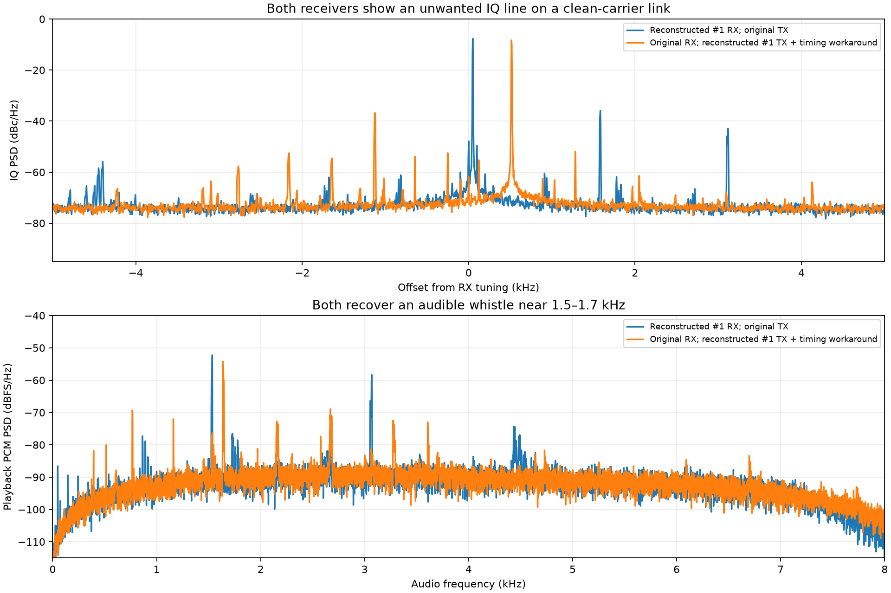
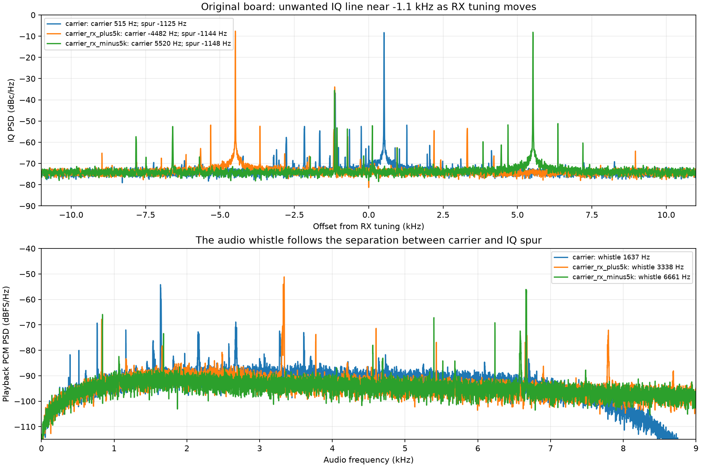

# Reversed-link receiver whistle comparison

2026-11-22. The 37.125 MHz board on **pi0b transmitted successfully with the
process-local SMI 2/12/6 timing workaround at 1 MS/s**, and the original board
on **pi0a received**. The original receiver also shows a whistle in decoded IQ
and playback, reproduced by an independent FM discriminator. Its tuning-offset
behavior is similar to the [first-direction experiment](../20261122-pi0-whistle/README.md).
The symptom is therefore not confined to the reconstructed board in its RX role.
The exact source is still unresolved; this does not establish identical physical
root causes or qualify the wrong-clock transmitter for normal operation.

## Workaround and independent source check

The current backend still requests SMI write setup/strobe/hold 1/4/2. The existing
`firmware/diagnostics/tx_timing_probe.c` intercepts precisely that request and
updates the expected-settings object to retain real driver readback checks.
No adaptation to the production source was needed. The preload and
`CARIBOULITE_TX_WRITE_TIMING=2,12,6` applied only to pi0b's diagnostic TX process.

A lower-power pilot at -12 dBm passed before the main tests:

- Actual timing readback: 2/12/6, pace 1.
- Stable demand: **100.28 application frames/s**, approximately nominal 100.
- No reported TX write errors or driver underruns.

A 65-second clean-carrier interval then ran at **430.100 MHz / 0 dBm**, with
synthetic audio amplitude zero and CTCSS off. The user independently monitored
it on the RSP2pro and reported **“Clean audio; no whistle.”** This is an auditory
reference check, not a captured RSP2pro spectrum or a calibrated spur limit.
See [pilot telemetry](pilot.json), [source-check telemetry](source-check.json),
and [RSP2pro observation](rsp2pro-observation.json).

Normal installed application binaries, driver and FPGA firmware were not
replaced. As in the first-direction experiment, an isolated backend permitted
zero-amplitude `tx_tone` for a genuine silent digital input. It used the deployed
DSP objects. The build script and per-host binary hashes are retained.

## Link and acquisition

- TX: reconstructed board #1, pi0b-trixie (`192.168.6.69`), UUID
  `d8810044-c444-46f4-a548-703412cbf971`.
- RX only: original board, pi0a-trixie (`192.168.6.37`), UUID
  `c132d0e7-d7dd-457a-b105-4a5cd97e7e80`.
- Same user-reported nominal 90 dB cabled attenuation. It was not independently
  recalibrated. RX RSSI during the carrier/tone cases was about -94 to -92 dBm.
- TX stayed at 430.100 MHz, 0 dBm, NBFM, 1 MS/s, throughout the measurement cases.
  The `carrier_2m` case changes **RX only** to 2 MS/s; it does not test 2 MS/s TX.
- Same nine cases as the first direction: clean carrier; CTCSS-only with RX
  CTCSS off/on; 1 kHz at amplitude 0.4 with CTCSS off/on; clean carrier with
  RX tuning ±5 kHz; clean carrier at 2 MS/s RX; no-TX open-squelch noise control.
  CTCSS frequency/deviation were 88.5/200 Hz.
- Noise/carrier squelch bypassed for measurement; the same matched mode gains
  and calibrated playback settings were used. RX playback used the Logitech
  H650e on pi0a. Original FPGA LED states were restored after each RX session.
- After 3 seconds settling, the bounded in-memory capture saved four seconds
  of decoded IQ and six seconds of accepted S16_LE PCM at 48 kHz. Files were
  written at shutdown, outside acquisition. All captures have expected lengths.

## Receiver-relative interference line

| Original-board RX case | Desired IQ carrier | Unwanted IQ line | Expected separation | Raw FM line | Playback whistle |
| --- | ---: | ---: | ---: | ---: | ---: |
| Centered | +515.0 Hz | -1125.3 Hz | 1640.3 Hz | 1642.8 Hz | 1637.0 Hz |
| RX +5 kHz | -4482.3 Hz | -1144.4 Hz | 3337.9 Hz | 3339.1 Hz | 3337.6 Hz |
| RX -5 kHz | +5519.9 Hz | -1148.2 Hz | 6668.1 Hz | 6672.4 Hz | 6661.4 Hz |

The unwanted IQ component was approximately -26.6 / -25.4 / -26.1 dBc,
integrated over ±60 Hz and referenced to carrier power over ±80 Hz. These are
relative ADC/IQ measurements, not calibrated absolute RF powers. Sequential
cases show drift. Different IQ/PCM windows, FFT resolution and live audio clock
adaptation account for small differences; the drift mechanism is not identified.

The unwanted line remains near -1.14 kHz relative to RX tuning while the desired
carrier moves by ±5 kHz. Its separation from the carrier predicts the recovered
whistle. Both production NBFM replay and an independent float64 discriminator
recover the line. CTCSS and microphone input are unnecessary for reproduction.





The first-direction reconstructed receiver had an unwanted line near +1.6 kHz
and approximately -26.5 dBc in its centered case. The original receiver has a
similar-strength line on the other side of its desired carrier. This supports
investigating a shared receiver-side RF/baseband/IQ acquisition mechanism,
including common configuration, hardware, FPGA and SMI. These captures do not
identify the responsible component or prove every weaker spur has one cause.
The oscillator replacement remains necessary to restore the intended board
configuration and qualify its TX path; it should not be assumed to resolve a
symptom now reproduced on the original receiver.

## SINAD, health and cleanup

Original-board RX live 1 kHz SINAD was **19.933 dB without CTCSS** and
**19.989 dB with CTCSS**. The first-direction corresponding readings were
19.112 / 18.867 dB. These are individual settled status readings, not calibrated
averages or a statistical equivalence test. Receive levels were similar.

All nine capture windows had zero increments in RF/audio FIFO drops, RX read
errors, playback underruns/write errors, PCM clipping, TX write errors and TX
driver underruns. All eight active-TX measurement endpoints read modem TX
state 0x04 and timing 2/12/6. See [health deltas](analysis/health.json).

At completion, the TX helper reported IDLE, modem TRXOFF 0x02 and restored SMI
write timing **1/5/1**, pace 1. No radio backend or experiment helper remained
on either host in the final process checks. Both radios were left stopped.

## Evidence and reproduction

- [Original-board clean-carrier audio](analysis/carrier.wav),
  [CTCSS-only audio](analysis/ctcss_only_rx_on.wav),
  [1 kHz audio](analysis/tone_1k.wav). These are original PCM with no normalization.
- [Receiver comparison](analysis/receiver-comparison.png),
  [localization CSV](analysis/localization.csv), [summary](analysis/summary.json),
  [paired statuses](measurements.json), [test plan](plan.json).
- [Original IQ/PCM and logs archive](captures.tar.gz), approximately 77 MiB gzip.
  IQ: little-endian signed int16 I,Q at the case's RX rate. PCM: S16_LE, 48 kHz,
  channel count in `capture.json`. Each case has four seconds of IQ and six of PCM.
- Source tap, TX build script, unchanged timing-probe source, remote helper,
  orchestration, replay and analysis scripts are alongside this file.
  [SHA256SUMS](SHA256SUMS) covers the evidence.

For offline analysis, extract the archive into
`build/whistle-reverse-analysis/data/`, compile `/tmp/cl-whistle-decode` as in the
[first report](../20261122-pi0-whistle/README.md#reproduce-analysis), then run
`analyze.py`, `summarize.py` and `compare_receivers.py` from this directory via
Python. NumPy, SciPy and Matplotlib are required. The comparison plot also needs
the first-direction capture archive extracted at its original documented path.
The analysis scripts access saved files only; `run_measurements.py` operates
physical hardware and must be treated separately.

To reuse the workaround manually on pi0b, with other radio owners stopped,
prepend the environment below to the normal backend launch and keep TX at
1 MS/s:

```sh
CARIBOULITE_TX_WRITE_TIMING=2,12,6 \
LD_PRELOAD="$PWD/build/whistle-reverse/tx_timing_probe.so" \
./build/radio-backend/cariboulite_radio_backend \
  --tx-sample-rate 1000000 --tx-frequency 430100000 --tx-power 0 \
  --rx-playback plughw:CARD=USB,DEV=0 \
  --tx-microphone plughw:CARD=USB,DEV=0
```

The backend starts idle; use the normal controller to start/stop TX. The preload
is process-local. This experiment does not qualify higher TX rates, long-term
operation, spectrum compliance or operation without the timing workaround.
