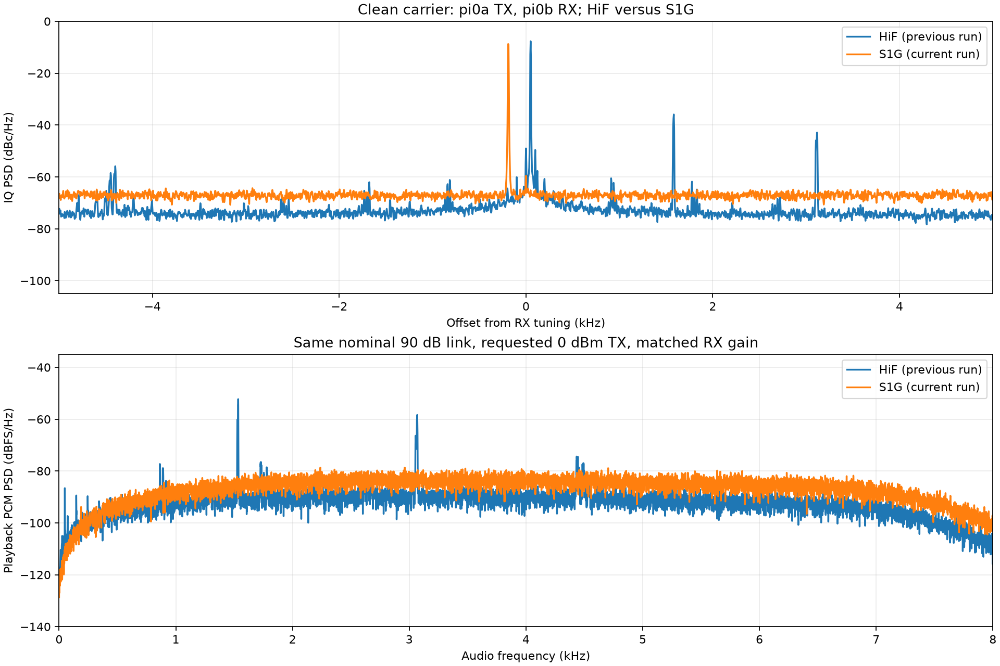

# S1G follow-up to the receiver whistle investigation

22 November 2026. The strong HiF whistle was **not reproduced on S1G** with
pi0a as TX and pi0b as RX. The centered clean-carrier capture has neither the
previous prominent IQ line near +1.6 kHz nor its approximately 1.5 kHz playback
tone. S1G has a higher broadband noise floor and smaller residual features;
this is not a claim of perfectly silent or spur-free reception.

## Setup and procedure

- TX: original board on pi0a, UUID `c132d0e7-d7dd-457a-b105-4a5cd97e7e80`.
- RX: reconstructed board on pi0b, UUID `d8810044-c444-46f4-a548-703412cbf971`.
- Operator moved the nominal 90 dB attenuated cable link to both S1G ports.
  Attenuation and absolute RF power were not independently calibrated.
- Both backends explicitly selected `--channel RF09`. Requested frequency was
  430.100 MHz, NBFM, requested/reported TX power 0 dBm, TX rate 1 MS/s and
  total deviation 2500 Hz. The modem reported 430.099936 MHz at center tuning.
- The same nine cases as the [original HiF run](../20261122-pi0-whistle/README.md)
  were repeated: carrier, CTCSS-only with RX tone squelch off/on, 1 kHz tone
  without/with CTCSS, carrier with RX tuned +5/-5 kHz, 2 MS/s RX, and no TX.
  Tone amplitude was 0.4; CTCSS was 88.5 Hz at 200 Hz TX deviation. CDCSS was
  disabled throughout. Microphone compression does not process synthetic tone.
- The matched RX gain profile and `am=-7`, `usb=0`, `lsb=0` trims were retained.
  Noise/carrier squelch was bypassed; CTCSS gating was selected only for its
  specified cases. Playback used pi0b's Jabra USB device.
- Application source revision: `1514ab0`. RX used the installed backend. An
  isolated TX probe relaxed only the controller acceptance check for exact
  zero tone amplitude, linking the current deployed DSP objects. Installed
  binaries were not replaced. No TX timing workaround was used on pi0a.
- After three seconds settling, each case captured four seconds of signed
  int16 decoded IQ and six seconds of actual accepted 48 kHz playback PCM.
  The process-local tap buffered in RAM and wrote files during shutdown.
  Both radios had duration limits and helper heartbeat timeouts.

## Results

| Measurement | Previous HiF | S1G |
| --- | ---: | ---: |
| Centered carrier offset in IQ | +49.6 Hz | -190.7 Hz |
| Clean-carrier playback power, 300–3000 Hz | -47.03 dBFS | -51.00 dBFS |
| Playback power around previous whistle, 1534.4 ±60 Hz | -47.64 dBFS | -64.45 dBFS |
| Live 1 kHz SINAD, CTCSS off | 19.112 dB | 20.722 dB |
| Live 1 kHz SINAD, CTCSS on | 18.867 dB | 20.378 dB |

The approximately **16.8 dB** reduction in the old whistle band is a comparison
of integrated audio power, including noise. It is not a measurement of a
remaining S1G whistle: there is no comparable narrow line in that band.
The IQ comparison is normalized to carrier power; audio retains its original
gain and has not been normalized.

S1G RX RSSI was approximately -101 dBm in the centered carrier case, versus
about -92 dBm in the previous HiF run. The receive power/SNR therefore was not
matched between channels despite equal requested TX power and nominal link
attenuation. S1G's higher broadband floor is visible in both IQ and audio.
The SINAD improvement should not be treated as a calibrated channel ranking.

Offset tuning reveals a smaller, different residual. With RX +5 kHz, the
carrier appears at -5233.8 Hz, and raw/playback audio peaks occur at
5233.2/5230.2 Hz. With RX -5 kHz, the carrier is at +4783.6 Hz and audio peaks
occur at 4784.9/4783.4 Hz. A weak IQ component at zero frequency is visible;
the frequency agreement is consistent with beating against DC. This differs
from the HiF component displaced from zero by about 1.6 kHz. The independent
float64 discriminator reproduces these offset-case audio peaks.

IQ Welch spectra in this report use `detrend=False` to retain true DC. The
previous HiF spectrum is recomputed with the same setting for comparison.
The centered carrier's strongest selected audio/noise peaks do not necessarily
correspond to the DC beat; the table in `localization.json` keeps those values
separate. Weak CTCSS harmonics and other small features also remain in the
control cases. The no-TX case is an open-squelch noise control.

All nine captures have their expected lengths. All measured capture-window
deltas for RX queue drops, playback underruns/errors, reader errors, TX writer
errors, driver underruns and playback clipping are zero. Both radio processes
were stopped, original FPGA LED state was restored, and an independent process
scan found no remaining owners on either Pi.

## Interpretation

The strong whistle depends on the tested HiF configuration and was not common
to these S1G captures. That makes the HiF signal path, its mixer/LO environment
and the RF24-specific modem path more relevant suspects. This experiment changes
both TX and RX channels, analog paths and received signal level; it does not
identify a component or completely exclude shared FPGA/SMI circuitry under
different channel conditions. Previous clean RSP2pro listening checks support
the receiver-side localization, but no independent receiver measurement was
made during this S1G run. No hardware or DSP fix was applied.

## Evidence and reproduction

- [Clean-carrier audio](analysis/carrier.wav), [1 kHz audio](analysis/tone_1k.wav),
  [CTCSS-only audio](analysis/ctcss_only_rx_on.wav), all without normalization.
- [Channel comparison](analysis/channel-comparison.png),
  [centered detail](analysis/carrier.png), [offset comparison](analysis/localization.png),
  [all control cases](analysis/comparison.png).
- [Comparison metrics](analysis/channel-comparison.json),
  [capture health](analysis/health.json), [full statuses](measurements.json),
  [plan](plan.json), [shutdown check](shutdown-check.json).
- [Original captures](captures.tar.gz), [checksums](SHA256SUMS), source helpers,
  isolated build provenance and analysis scripts are retained beside this report.

Extract the archive into `build/whistle-s1g-analysis/data/`. Compile the replay
decoder using the command in the original HiF report with this directory's
`decode_iq.c`, then run `analyze.py`, `summarize.py` and `compare_channels.py`
with NumPy/SciPy/Matplotlib. Channel comparison also requires the original HiF
archive extracted in `build/whistle-analysis/data/`. `run_measurements.py`
operates physical hardware and is separate from offline analysis.
