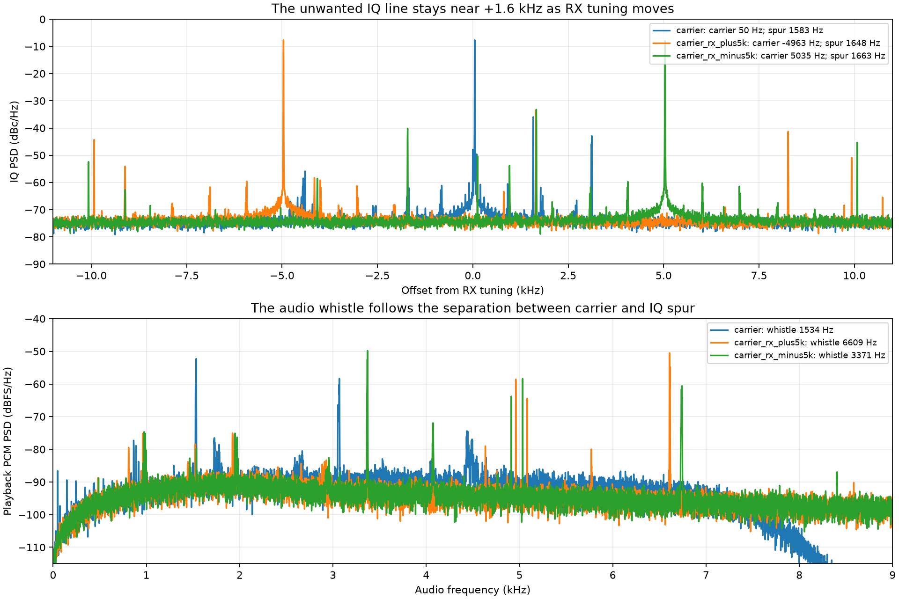

# Pi Zero receiver whistle: physical IQ and audio captures

2026-11-22. The whistle was reproduced and traced to a receiver-relative
interference line already present in decoded IQ. A separate float64 FM
implementation reproduces it. The strongest localization evidence is that the
unwanted IQ line stays near +1.6 kHz relative to RX tuning while the desired
carrier moves when RX is tuned ±5 kHz. The audible line follows their
frequency separation. CTCSS is not required for the artifact.

The exact physical component is **not identified or fixed**. The evidence
focuses investigation on the receiver-side RF/baseband/IQ acquisition path,
including hardware, FPGA and SMI. It does not distinguish those components.
The user's clean RSP2pro reception is supporting context, not a reference
measurement acquired in this run.

## Setup and procedure

- TX: original reference board on pi0a-trixie, UUID
  `c132d0e7-d7dd-457a-b105-4a5cd97e7e80`.
- RX only: reconstructed board #1 on pi0b-trixie, UUID
  `d8810044-c444-46f4-a548-703412cbf971`.
- Cabled link with nominal 90 dB attenuation, as reported by the user; attenuation
  was not independently calibrated during this run.
- TX 430.100 MHz, requested and reported actual power 0 dBm, NBFM, 1 MS/s,
  2500 Hz nominal total deviation. Typical reported RX RSSI was about -92 dBm.
- RX normally 430.100 MHz / 1 MS/s; offset cases used 430.105 / 430.095 MHz.
  One case used 2 MS/s RX with the TX rate unchanged.
- Synthetic TX source: exact zero amplitude for clean-carrier/CTCSS-only cases;
  1000 Hz at amplitude 0.4 for SINAD cases. No microphone input or compressor
  processing was involved. CTCSS cases used 88.5 Hz and 200 Hz tone deviation.
- An isolated TX binary changed only the backend acceptance check to permit
  zero-amplitude `tx_tone`. It linked the deployed DSP objects. Normal installed
  binaries were not replaced. The build script and binary hash are retained.
- RX used the installed backend and the same matched gain profile / per-mode
  trims as the user's launch. Noise and carrier squelch were bypassed to permit
  measurement; selected CTCSS tone squelch was enabled in two specified cases.
  Playback remained the Jabra USB device. Original FPGA LED states were restored.
- After 3 seconds settling, SIGUSR1 armed a bounded capture: 4 seconds of decoded
  signed-16-bit IQ and 6 seconds of the actual accepted ALSA playback samples.
  The tap copied data into prefaulted RAM and wrote files only at shutdown.
  PCM is tapped before ALSA plug conversion and USB hardware.
- All nine captures completed at their expected lengths. No new RF/audio FIFO
  drops, playback underruns/errors, RX read errors, TX write errors, driver
  underruns or PCM clipping were recorded during the capture windows.
- Every helper had a heartbeat timeout and backend duration limit. Both radio
  processes were stopped and absence of remaining owners was checked afterward.

## Results

| Case | Desired carrier offset in IQ | Unwanted IQ line | Expected beat | Measured raw FM line | Measured playback line |
| --- | ---: | ---: | ---: | ---: | ---: |
| RX centered | +49.6 Hz | +1583.1 Hz | 1533.5 Hz | 1535.2 Hz | 1534.4 Hz |
| RX +5 kHz | -4962.9 Hz | +1647.9 Hz | 6610.9 Hz | 6612.3 Hz | 6608.6 Hz |
| RX -5 kHz | +5035.4 Hz | +1663.2 Hz | 3372.2 Hz | 3372.8 Hz | 3370.6 Hz |

The unwanted IQ component was approximately -26.5 / -25.3 / -25.5 dBc in
these cases, integrated over ±60 Hz and referenced to carrier power over ±80 Hz.
These are ADC/IQ spectral ratios, not calibrated absolute RF powers. The line
drifted during the sequential measurements. Welch resolution, drift, different
IQ/PCM observation windows and live audio clock adaptation explain small
frequency differences; the experiment does not identify the drift mechanism.



The centered clean-carrier case also contains an audible harmonic near
3068 Hz in playback. CTCSS-only and 1 kHz + CTCSS cases retain the unwanted
line. The 2 MS/s RX case retains a similar artifact near 1.65 kHz; because cases
were sequential and the line drifted, this does not establish exact rate
invariance. The no-TX, open-squelch case provides the noise-floor control;
it is not a clean-silence recording.

The live 1 kHz SINAD reading was **19.112 dB with CTCSS off** and
**18.867 dB with 88.5 Hz / 200 Hz-deviation CTCSS**. This reproduces the user's
approximately 19.0 / 18.9 dB observations. The readings alone neither explain
nor exclude the whistle.

Production-DSP IQ replay and an independent float64 discriminator both show
the unwanted line before audio output. This excludes a whistle generated
solely by the CTCSS decoder, live audio clock controller, ALSA conversion or
USB/headset playback. Existing digital FM demodulation is responding to an
artifact already present in IQ. This is localization evidence, not proof of a
particular analog fault or FPGA bug.

## Files

- [Clean-carrier audio](analysis/carrier.wav),
  [CTCSS-only audio with RX CTCSS enabled](analysis/ctcss_only_rx_on.wav),
  [1 kHz audio](analysis/tone_1k.wav): original playback PCM, no normalization.
- [Localization plot](analysis/localization.png),
  [centered-carrier detail](analysis/carrier.png),
  [RX +5 kHz detail](analysis/carrier_rx_plus5k.png),
  [all control-case comparison](analysis/comparison.png).
- [Localization CSV](analysis/localization.csv), [summary](analysis/summary.json),
  [capture health deltas](analysis/health.json), [full paired statuses](measurements.json).
- [Original captures archive](captures.tar.gz): all original IQ, PCM, capture
  metadata, backend logs and status/command records. Approximately 74 MiB gzip.
  IQ is little-endian signed int16 I,Q; PCM is S16_LE at 48 kHz with channel
  count specified by each `capture.json`. IQ rate is in `plan.json`.
- [Checksums](SHA256SUMS), source capture tap, isolated build script, helper,
  experiment runner, replay decoder and analysis scripts are alongside this file.

## Reproduce analysis

Extract `captures.tar.gz` into `build/whistle-analysis/data/` from the repository
root. Compile the replay helper using the repository DSP source:

```sh
cc -std=c11 -D_GNU_SOURCE -O3 -ffast-math -fno-math-errno -funroll-loops \
  -Isoftware/libcariboulite/src \
  docs/baselines/20261122-pi0-whistle/decode_iq.c \
  software/libcariboulite/src/nbfm_demod.c \
  software/libcariboulite/src/nbfm_demod_dsp.c \
  software/libcariboulite/src/wbfm_demod.c \
  software/libcariboulite/src/am_demod.c -lm -o /tmp/cl-whistle-decode
python3 docs/baselines/20261122-pi0-whistle/analyze.py
python3 docs/baselines/20261122-pi0-whistle/summarize.py
```

Analysis requires NumPy, SciPy and Matplotlib. `analyze.py` replays the exact
production NBFM DSP with zero clock correction and compares a float64 channel
filter/phase-difference implementation. `summarize.py` validates the captured
health deltas and produces WAVs, plots, the archive and checksums. Running
`run_measurements.py` operates physical hardware and is separate from analysis.

## Reversed-link follow-up

The [reversed-link experiment](../20261122-pi0-whistle-reversed/README.md)
subsequently used the reconstructed board as TX with the 1 MS/s timing
workaround and the original board as RX. The original receiver showed a similar
receiver-relative IQ spur and audible whistle. The user reported clean TX audio
on an independent RSP2pro listening check. This symptom therefore provides no
evidence of a fabrication fault unique to the reconstructed receiver; the exact
source remains unresolved and the oscillator mismatch remains a separate defect.
