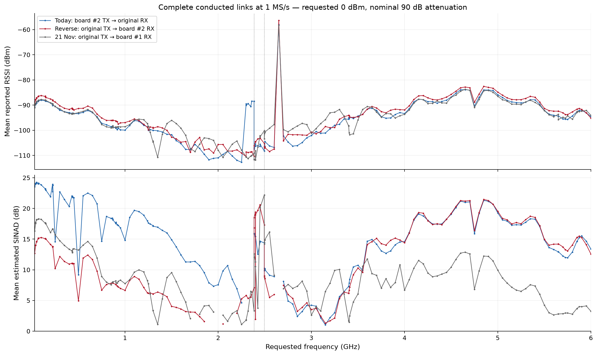
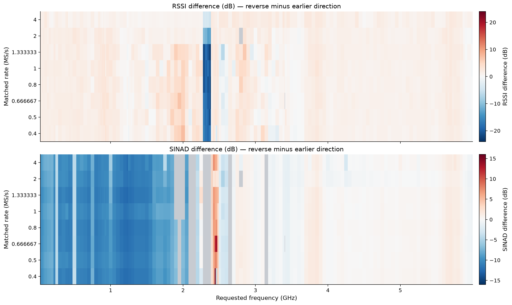

# Reciprocal sweep comparison: original board and repaired device #2

Both directions use the same two boards, software builds, Logitech H650e headset, frequency/rate grid and nominal 90 dB HiF link. The operator moved the headset to whichever Pi was receiving. TX requests and reports 0 dBm; the source is a 1 kHz NBFM tone of amplitude 0.4 with deviation setting 2,500 Hz.

| Dataset | TX | RX |
|---|---|---|
| Earlier direction, 23 November | Repaired device #2, pi0b | Original, pi0a |
| Reverse direction, 23 November | Original, pi0a | Repaired device #2, pi0b |
| Historical reference, 21 November | Original, pi0a | Board #1, pi0b |

Across **1,269 matched points** with fully valid SINAD and clean transport in both directions, median **reverse minus earlier SINAD** is **-1.18 dB**. Each frequency/rate point carries equal weight; missing estimates are excluded, not assigned zero.

Using the original board as TX in both runs, the median **board #2 RX link minus historical board #1 RX link** is **+0.15 dB** across **1,310 clean, fully valid pairs**. The historical run used a different software build and playback device, and occurred on a different day. This is a qualified link comparison, not an isolated oscillator-repair result.

## Frequency response at 1 MS/s



[Vector figure](comparison/three-links-1msps.svg). Lines connect measured settings; gaps mean no numeric estimate. The curves include partially valid SINAD windows, whose fractions remain in the paired CSV. Paired statistics below require complete validity and clean transport.

| MHz | Earlier SINAD dB | Reverse SINAD dB | Historical board #1 SINAD dB |
|---:|---:|---:|---:|
| 30.000 | 23.54 | 12.68 | 16.32 |
| 430.100 | 22.03 | 11.07 | 13.10 |
| 1000.000 | 14.82 | 6.64 | 7.74 |
| 1350.000 | 16.95 | 6.37 | 1.11 |
| 1750.000 | 11.39 | 3.09 | Unavailable |
| 2000.000 | 7.58 | Unavailable | Unavailable |
| 2300.000 | Unavailable | 5.80 | 1.80 |
| 2385.000 | 15.84 | 16.82 | 12.04 |
| 2399.900 | 15.41 | 19.41 | 11.31 |
| 2400.000 | Unavailable | 1.94 | Unavailable |
| 2450.000 | 14.66 | 20.14 | 20.14 |
| 2494.900 | 14.37 | 17.31 | 22.20 |
| 2650.000 | Unavailable | Unavailable | Unavailable |
| 3150.000 | 1.04 | 1.31 | 6.47 |
| 4650.000 | 20.99 | 21.20 | 12.87 |
| 5999.999 | 13.37 | 12.56 | 3.24 |

## Paired sample-rate summary

| Rate MS/s | Clean full pairs, directions | Median reverse − earlier SINAD dB | Median reverse − earlier RSSI dB | Clean full pairs, board #1 | Median board #2 RX − board #1 RX SINAD dB |
|---:|---:|---:|---:|---:|---:|
| 4 | 158 | -1.21 | +1.27 | 163 | +0.16 |
| 2 | 157 | -1.32 | +1.40 | 163 | +0.34 |
| 1.333333 | 158 | -1.15 | +1.49 | 162 | +0.32 |
| 1 | 158 | -1.12 | +1.49 | 163 | -0.10 |
| 0.8 | 160 | -1.08 | +1.43 | 165 | +0.10 |
| 0.666667 | 159 | -1.17 | +1.41 | 165 | +0.13 |
| 0.5 | 160 | -1.20 | +1.44 | 165 | +0.15 |
| 0.4 | 159 | -1.28 | +1.38 | 164 | +0.09 |

RSSI differences require clean transport at both points. SINAD differences additionally require numeric estimates throughout both windows, so the RSSI and SINAD populations can differ. Full validity fractions and flags are retained in [paired-results.csv](comparison/paired-results.csv).

## Frequency-region comparison

| Frequency region | Direction pairs | Median reverse − earlier SINAD dB | Board #1 pairs | Median board #2 RX − board #1 RX SINAD dB |
|---|---:|---:|---:|---:|
| Below 2385 MHz | 576 | -10.25 | 606 | -1.80 |
| 2385 to below 2495 MHz | 63 | +3.46 | 64 | +5.20 |
| 2495 MHz and above | 630 | +0.15 | 640 | +8.23 |

These regions separate the native RF24 bypass band from the frequency settings below and above it. All eight rates contribute equally per retained frequency/rate point. Clustered frequency anchors remain equally weighted, so the figures are descriptive grid summaries rather than uniform-band integrals.

## Direction differences across the grid



[Vector figure](comparison/direction-differences.svg). Positive red means the reverse direction reports a higher value; negative blue means the earlier direction reports a higher value. Gray cells are excluded pairs. The actual nonuniform frequency spacing is preserved.

## Acquisition and estimator availability

| Dataset | Matrix points | No numeric SINAD | Partially valid SINAD | Transport-flagged windows | Failed setup attempts |
|---|---:|---:|---:|---:|---:|
| Earlier direction | 1376 | 66 | 7 | 2 | 10 |
| Reverse direction | 1376 | 38 | 2 | 0 | 0 |
| Historical board #1 | 1376 | 35 | 3 | 0 | 0 |

A failed setup attempt is distinct from a retained measurement-window error. All three datasets contain the complete matrix; fault and retry details remain in each dataset’s progress and controller logs. An unavailable estimate does not establish absent RF.

## What this comparison establishes

Reversing the pair tests whether the complete link is symmetric. It changes both the transmitter and receiver roles together. A difference cannot uniquely identify TX modulation quality, actual RF output power, RX noise/distortion, oscillator behavior, conversion spurs or external interference. Requested 0 dBm and nominal attenuation are not independently calibrated power at the receiver connector.

The two directions ran sequentially, so environmental changes and temperature are also possible contributors. Sample rates changed on both boards together. The measurements do not establish a standalone receiver-sensitivity or manufacturing-quality ranking.

## Operator follow-up and interpretation

The operator heard no whistle or additional noise from repaired device #2,
relative to the original board, while receiving PI2NOS at 430.125 MHz. This is
a useful listening observation with a different signal and frequency from the
sweep's synthetic 1 kHz tone at 430.1 MHz; it is not a repeat of that test point.

Using the same RSP2pro at 430.1 MHz, with both transmitting boards warm, the
operator measured steady carrier offsets with no observed drift:

| Board | Reported carrier offset | Equivalent fractional error |
|---|---:|---:|
| Original | -600 Hz | -1.395 ppm |
| Repaired device #2 | -79 Hz | -0.184 ppm |

The relative difference is **521 Hz, or 1.211 ppm**. These are operator
measurements, not recorded RSP2pro captures or independently calibrated absolute
frequency measurements. They support a stable reference/tuning difference;
they do not identify its component or establish an explanation for the SINAD gap.

The similar RSSI curves and differing SINAD motivate checking recovered-audio
distortion, discrete spurs, noise and estimator behavior. Similar received power
does not establish equal receiver sensitivity: no input-level sensitivity sweep
was performed. The operator's microscope comparison also found the two modem
balun positions and mixer transformers visually consistent between boards,
weakening the suspected gross balun swap without verifying fitted part numbers.

The backend SINAD estimator uses a fixed 1 kHz notch (Q=30), without tracking
the measured audio tone. Its calculated steady-state response would limit a
perfectly clean 1005 Hz tone to about 10.8 dB apparent SINAD. No such audio
frequency offset has been measured here. A constant RF carrier offset is
distinct from an audio tone-frequency error; in an ideal FM discriminator it
adds DC. Even if the 1.211 ppm relative error also affected the audio clock,
it would move a 1 kHz tone by only about 0.0012 Hz. The 521 Hz carrier difference
alone therefore does not establish the fixed-notch explanation.

A focused follow-up would retain IQ and pre-volume demodulated audio, measure
carrier and tone offsets, compare carrier-centered demodulation, track the audio
fundamental when recomputing SINAD, and inspect harmonic/nonharmonic residuals.
That experiment remains outstanding. These notes do not change the archived
sweep results or isolate TX and RX contributions.

## Evidence and regeneration

- [Reverse sweep report](REPORT.md) and [point CSV](results.csv).
- [Earlier direction report](../20261123-pi0-board2-tx-frequency-rate-sweep/REPORT.md).
- [Historical board #1 report](../20261121-pi0-board1-frequency-rate-sweep/REPORT.md).
- [Comparison summary](comparison/summary.json), [paired CSV](comparison/paired-results.csv), and [source](comparison/analyze_comparison.py).

From this baseline directory, with NumPy and Matplotlib installed:

```sh
MPLCONFIGDIR=/tmp/cariboulite-matplotlib python3 comparison/analyze_comparison.py .
```
