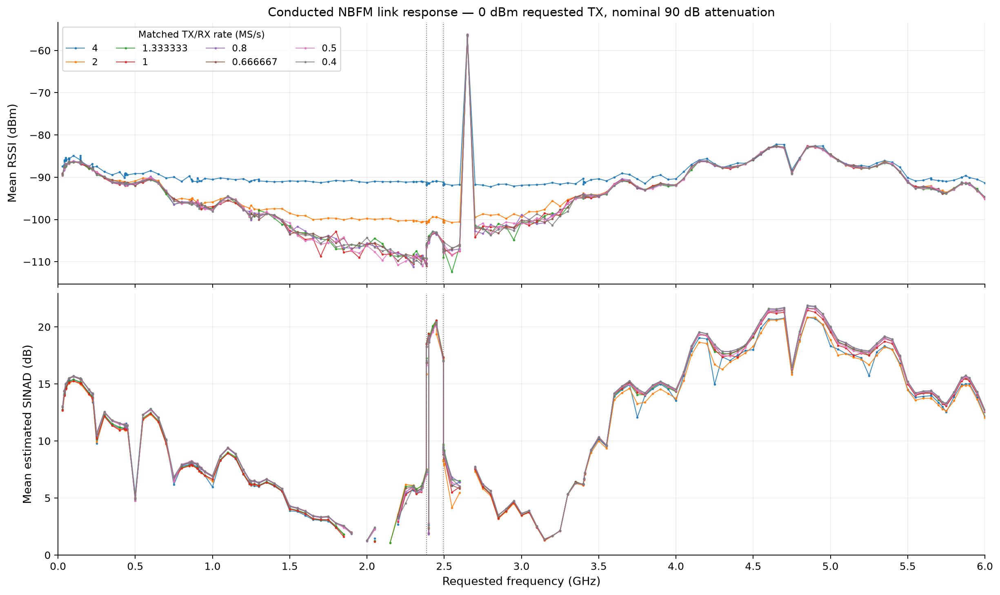
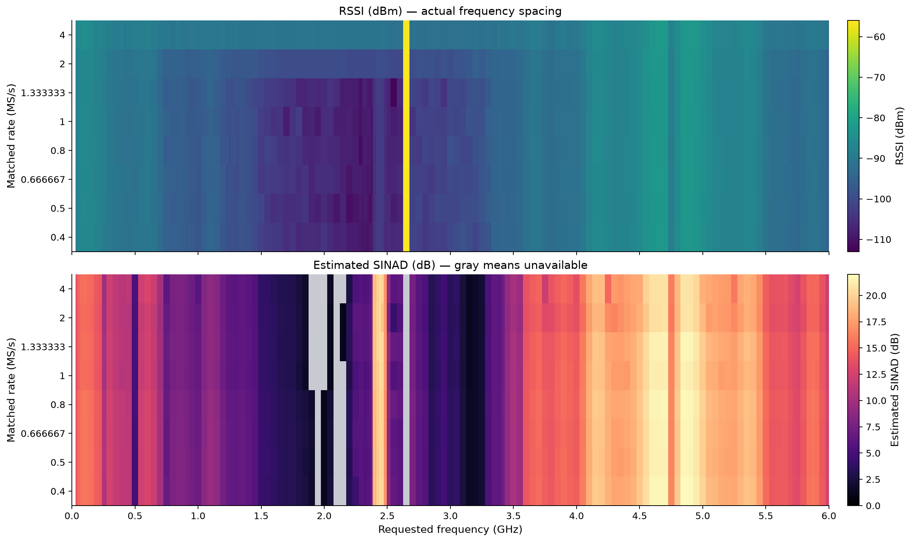
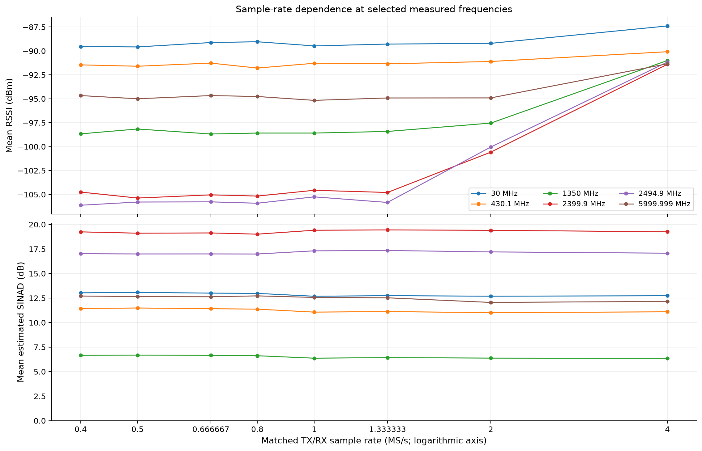
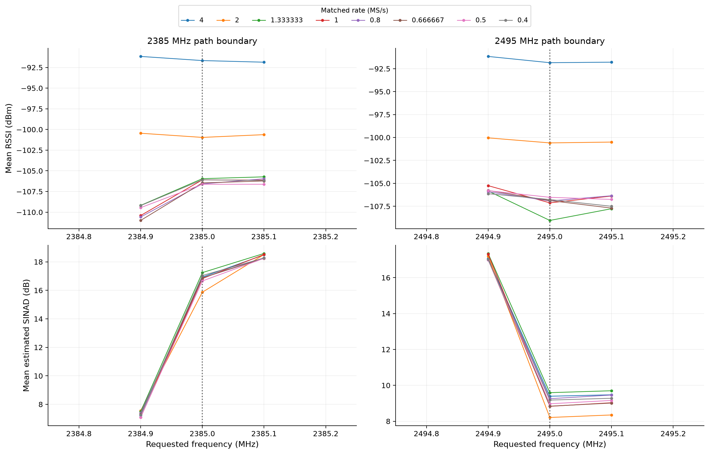

# Repaired CaribouLite device #2 RX frequency and sample-rate sweep

**23 November 2026 · 17:57–21:27 Europe/Brussels · pi0a TX → pi0b RX**

## Results

All **1,376 planned measurements** completed: **172 frequencies × eight matched TX/RX sample rates**, at requested and hardware-reported **0 dBm TX** through the user-confirmed nominal **90 dB attenuated RF24/HiF link**. Independent verification passed against **31,915 paired snapshots**, including eight preflight measurements. The main matrix contains **31,727 pairs**.

Numeric SINAD is available at **1,338/1,376 points**; **38 points have no numeric estimate**, and **2 additional windows are partially valid**. Missing SINAD remains blank in the CSV. **0 matrix windows** showed increases or resets in the selected transport counters.

The best transport-clean point mean is **21.88 dB SINAD at 4850 MHz and 0.4 MS/s**. This describes the complete link and the backend estimator; it does not establish calibrated receiver sensitivity.

## Setup

| Item | Setting |
|---|---|
| TX | Original reference board on `pi0a-trixie`, `192.168.6.37` |
| TX board UUID | `c132d0e7-d7dd-457a-b105-4a5cd97e7e80` |
| RX | Repaired device #2 on `pi0b-trixie`, `192.168.6.69`; RX only |
| RX board UUID | `36b67ac4-b313-4369-99bd-4b3e09caabfa` |
| RX oscillator | Correct 125 MHz oscillator fitted, as reported by the operator; no oscillator timing workaround |
| RF path | HiF/RF24 ports, nominal 90 dB attenuated conducted link |
| Frequency grid | 172 frequencies, 30 MHz–5,999.999 MHz; 50 MHz grid plus band anchors and path boundaries |
| Rates | 4, 2, 1.333333, 1, 0.8, 0.666667, 0.5, 0.4 MS/s; TX and RX changed together |
| TX signal | NBFM; 1 kHz sine, amplitude 0.4; deviation setting 2,500 Hz |
| Power | Requested and reported 0 dBm at every retained sample; no independent RF power calibration |
| Signalling | TX/RX CTCSS and CDCSS off |
| RX gain profile | `matched`, with `am=-7`, `usb=0`, `lsb=0` |
| RX controls | Carrier/noise squelch disabled; LED1 held low, original LED state restored on release |
| RX playback | Same Logitech H650e USB headset moved from pi0a to pi0b by the operator |
| Reference clock drive | Standard 8 mA setting, no drive override or preload |
| Acquisition | 2 s settling, 5 s measurement per point; fresh sequences and monotonic timestamps on each host |
| SINAD | Backend NBFM 1 kHz estimate over 300–3,000 Hz |

Exactly 6 GHz is excluded by the radio API, so the highest setting is 5,999,999,000 Hz. The fractional native rates are 4 MHz divided by 3 and 6, with rounded integer command labels. RX analog bandwidth remains 160 kHz and TX analog bandwidth 80 kHz; digital cutoff changes with rate from 500 kHz to 50 kHz. Thus each sample-rate setting changes a complete profile on both boards.

The oscillator replacement was reported by the operator. This sweep checks functional operation with the standard driver, including 4 MS/s RX; it does not independently measure oscillator frequency or phase noise. The microphone compressor is enabled in configuration but is microphone-only, so it does not process this synthetic tone source.

## Frequency response



[Vector figure](analysis/frequency-overview.svg). Points are discrete measured settings. Connecting lines guide the eye; missing SINAD interrupts the curves. Dotted lines mark the 2,385 and 2,495 MHz RF path boundaries. Black crosses identify transport-flagged windows.

Representative means at 1 MS/s:

| Frequency MHz | RSSI dBm | Estimated SINAD dB |
|---:|---:|---:|
| 30.000 | -89.48 | 12.68 |
| 430.100 | -91.29 | 11.07 |
| 1000.000 | -96.96 | 6.64 |
| 1350.000 | -98.58 | 6.37 |
| 1750.000 | -104.71 | 3.09 |
| 2000.000 | -105.67 | Unavailable |
| 2384.900 | -110.41 | 7.08 |
| 2385.000 | -106.10 | 16.82 |
| 2399.900 | -104.57 | 19.41 |
| 2400.000 | -104.47 | 1.94 |
| 2494.900 | -105.25 | 17.31 |
| 2495.000 | -107.12 | 8.83 |
| 2650.000 | -56.38 | Unavailable |
| 4650.000 | -82.83 | 21.20 |
| 5999.999 | -95.17 | 12.56 |

## Frequency and rate maps



[Vector figure](analysis/frequency-rate-heatmaps.svg). Frequency cells follow the actual nonuniform grid, with edges at neighboring midpoints. Rates are discrete rows. Gray SINAD cells indicate missing estimates; colors are not interpolated.

## Sample-rate summary

| Rate MS/s | Numeric SINAD / 172 | Transport flags | Median RSSI dBm | Median numeric SINAD dB | Points ≥12 dB | Median paired SINAD Δ vs 1 MS/s dB |
|---:|---:|---:|---:|---:|---:|---:|
| 4 | 166 | 0 | -90.38 | 12.12 | 85 | -0.02 |
| 2 | 167 | 0 | -93.13 | 11.86 | 83 | -0.07 |
| 1.333333 | 167 | 0 | -93.58 | 12.01 | 84 | +0.06 |
| 1 | 166 | 0 | -93.33 | 12.04 | 83 | +0.00 |
| 0.8 | 168 | 0 | -93.29 | 12.14 | 85 | +0.25 |
| 0.666667 | 168 | 0 | -93.47 | 12.17 | 85 | +0.23 |
| 0.5 | 168 | 0 | -93.13 | 12.18 | 85 | +0.20 |
| 0.4 | 168 | 0 | -93.25 | 12.20 | 85 | +0.28 |

Among **166 frequencies** with fully valid SINAD and clean transport at every rate, the median range between rate-specific means is **0.47 dB**, with a maximum of **3.51 dB**. The sweep measured one full frequency pass per rate, sequentially; time and temperature are therefore not separated from rate effects.

Medians weight every measured frequency equally, including clustered anchors. Numeric-SINAD medians exclude missing estimates. Paired differences retain only fully valid, transport-clean windows at both rates; counts are in [rate-summary.csv](analysis/rate-summary.csv). The ≥12 dB count is descriptive, not a sensitivity specification.



[Vector figure](analysis/rate-profiles.svg). TX and RX rates change together; these profiles cannot assign a change to one board.

The largest rate-dependent RSSI range is **20.52 dB at 2550 MHz**, spanning **-112.43 to -91.91 dBm**. Numeric SINAD means at this frequency span **4.16–6.83 dB**. A change in reported RSSI alone does not establish an equal change in wanted-signal input power.

## RF path boundaries



[Vector figure](analysis/path-boundary-zooms.svg). These zooms show the closely spaced measurements around the native-modem/mixer boundaries. Any coincident step remains a combined TX/RX link observation.

## Missing and partially valid SINAD

An unavailable estimate is not zero SINAD and does not establish that no RF signal was received. RSSI can include interference and conversion artifacts. Only finite numeric estimates contribute to the reported SINAD statistics.

| Frequency MHz | Rates with no numeric SINAD, MS/s |
|---:|---|
| 1900 | 4, 2, 1.333333, 1 |
| 1950 | All eight |
| 2000 | 4, 2, 1.333333, 1 |
| 2100 | All eight |
| 2150 | 4, 1, 0.8, 0.666667, 0.5, 0.4 |
| 2650 | All eight |

| Frequency MHz | Rate MS/s | Numeric snapshots / total |
|---:|---:|---:|
| 2150 | 2 | 17 / 24 |
| 2150 | 1.333333 | 19 / 24 |

## Acquisition integrity

The collector recorded **0 failed setup attempts**. A failed setup triggers a clean helper restart and one retry; failed partial windows are not retained as completed points. The matrix verifier checks every planned point is present exactly once.

**0 matrix windows** have transport flags. Flags are recomputed from every retained raw counter value, including checks for resets. They cover RX queue/audio drops, playback underruns/write errors, reader errors, alignment failures/invalid frames, and TX driver underruns, writer errors and queue drops.

Whole-session histories include startup, tuning and settling, so their cumulative counters can differ from the clean-window result:

- RX `alignment.invalid_frames`: peak **21**, total positive increments **21**.
- TX `driver.underrun_periods`: peak **4**, total positive increments **15**.

Independent checks verify host/board identities, RX-only operation, requested frequency/rate, requested and reported power, signalling off, tone settings, fresh sample sequences, RSSI/SINAD summary statistics, CSV consistency, and the complete 172 × 8 matrix. The receiver command audit found **zero TX commands**, and both backend release checks passed. Details are in [verification.json](verification.json) and [matrix-verification.json](matrix-verification.json).

All eight 430.1 MHz preflight measurements passed:

| Rate MS/s | Mean RSSI dBm | Mean SINAD dB |
|---:|---:|---:|
| 4 | -88.17 | 11.08 |
| 2 | -90.00 | 11.11 |
| 1.333333 | -90.42 | 11.09 |
| 1 | -91.00 | 11.03 |
| 0.8 | -91.22 | 11.03 |
| 0.666667 | -90.92 | 11.04 |
| 0.5 | -90.58 | 11.01 |
| 0.4 | -90.79 | 11.04 |

## Interpretation limits

These values characterize the complete transmitter–attenuator–receiver link. Requested power and nominal attenuation do not establish actual receiver input power over frequency. This run therefore does not measure receiver sensitivity, noise figure, or calibrated standalone TX/RX frequency response.

This run reverses today’s earlier pairing of repaired device #2 TX on pi0b and original RX on pi0a, using the same boards, software, headset and nominal RF link. A difference between directions cannot by itself separate transmitter purity, actual RF output power, receiver behavior or external interference. The 21 November board #1 RX baseline used the same original TX board but a different receiver and software version; it is not an isolated oscillator-repair comparison.

## Data and regeneration

- [Point measurements CSV](results.csv), [full point summaries](results.jsonl), and [test plan](plan.json).
- [Acquisition report](REPORT.txt), [host/snapshot verification](verification.json), and [matrix verification](matrix-verification.json).
- [Paired raw snapshots](paired-snapshots.jsonl.gz), [TX host archive](tx-host-artifacts.tar.gz), and [RX host archive](rx-host-artifacts.tar.gz).
- [Analysis summary](analysis/analysis-summary.json), [rate summary](analysis/rate-summary.csv), and [analysis source](analysis/analyze_sweep.py).

With Python, NumPy and Matplotlib installed, run from the baseline directory:

```sh
python3 verify_matrix.py .
MPLCONFIGDIR=/tmp/cariboulite-matplotlib python3 analysis/analyze_sweep.py .
```

The acquisition sources preserve original deployment addresses and key paths as historical records. Review them before reuse; running acquisition code transmits RF. Offline verification and analysis do not access hardware.

The source manifest preserves the original completion checksums. The package manifest covers the archived evidence, and the analysis manifest covers the generated report and figures.
