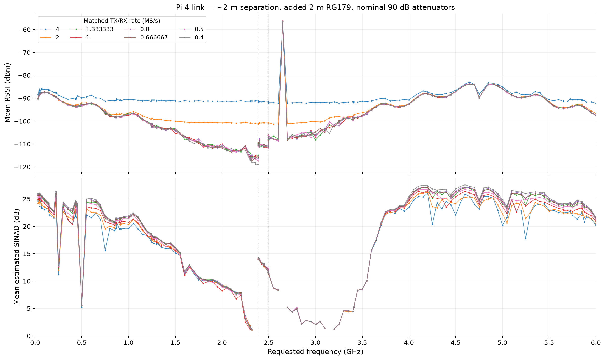
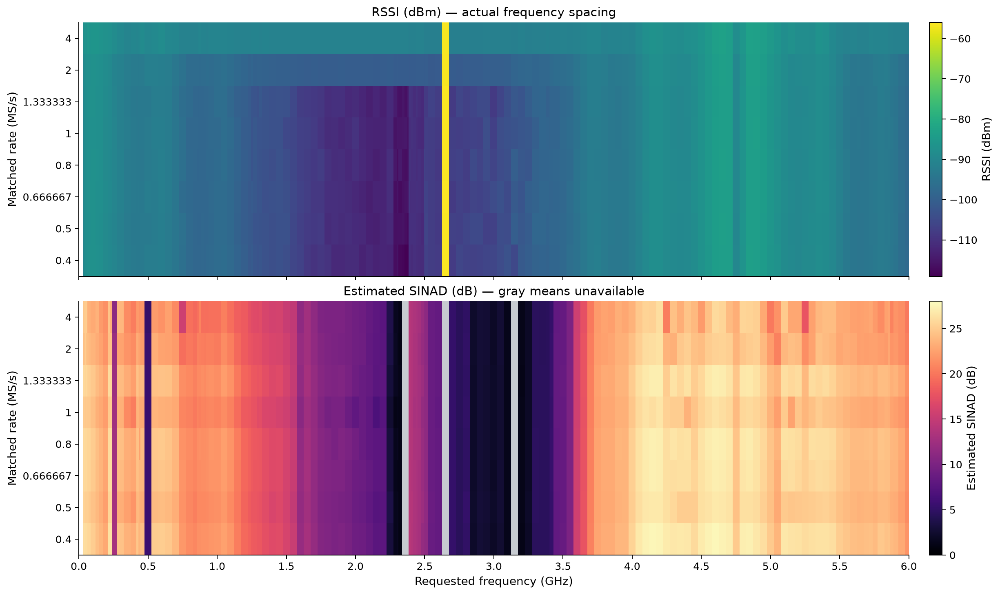
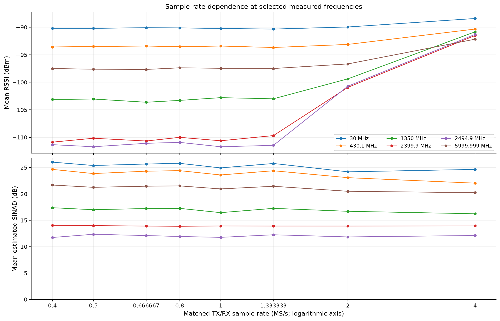
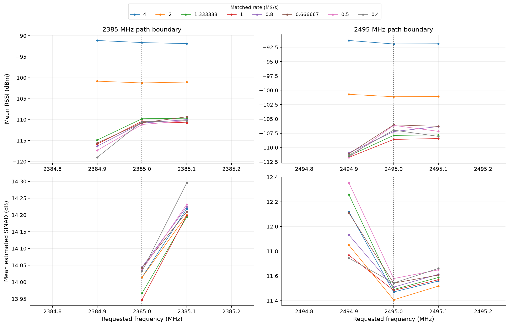

# Pi 4 full sweep with approximately two-metre separation

Original pi4g TX (192.168.6.77) to repaired board #2 pi4f RX (192.168.6.163).
Both hosts updated to GitHub dev-fpga-pa-control a997ec4 before this run.
Operator reports approximately 2 m separation, added 2 m RG179 and nominal 90 dB attenuators.
Added cable loss is additional and uncalibrated. These are complete TX/link/RX results.

Completed 1376 matrix points; independently verified 172 frequencies × eight matched rates.
Numeric SINAD: 1328/1376; transport-flagged windows: 0.

## Interpretation

The full run completed on 27 November 2026 at 12:39 Europe/Brussels. All 1,376 matrix points and eight preflight points passed independent acquisition verification against 32,989 paired snapshots. There were no recovered setup failures and no measured windows with increases or resets in the selected transport counters. Both radios were released; the receiver command audit found no TX commands.

Compared with the 23 November same-board Pi Zero reference, the median paired SINAD gain is 7.60–8.60 dB across the eight rates. Median reported RSSI differences range from -0.38 to -1.97 dB. Cleaner demodulation with somewhat lower reported input levels is consistent with reduced unwanted coupling; it does not establish a calibrated sensitivity improvement or isolate the effect of separation. Hosts, software, cable and geometry changed together, and this sweep does not directly measure the whistle spectrum.

Across all numeric points the median SINAD is 21.58 dB, versus 12.07 dB previously. The count of matrix points with numeric SINAD at least 12 dB rose from 675 to 978 out of 1,376 planned points. These statistics weight the nonuniform frequency grid equally and exclude missing estimates from the medians.

At 1 MS/s, 430.1 MHz improved from 11.07 to 23.60 dB, 1 GHz from 6.64 to 20.73 dB, 4.65 GHz from 21.20 to 26.12 dB, and 5999.999 MHz from 12.56 to 20.95 dB. A broad weak region persists around 2.2–3.4 GHz. The 2385 MHz <= f < 2495 MHz bypass region regressed: median fully valid paired SINAD difference -5.22 dB across 64 pairs. Improvement is therefore not uniform across frequency.

All eight rates lack numeric SINAD at 2350, 2360, 2384.9, 2400, 2650 and 3150 MHz: 48 missing matrix estimates. Nine further windows are partially valid. Missing SINAD is not zero and is not proof of no received signal. At 2650 MHz, reported RSSI is approximately -56 dBm while no numeric SINAD is available, so the peak cannot be counted as good reception. This sweep cannot identify the cause of that peak.

The 4 and 2 MS/s RSSI traces flatten near -91 and -101 dBm in parts of the weak region while narrower-rate traces fall lower. RSSI alone cannot rank receiver sensitivity across these rate profiles. Lower rates generally produce higher numeric SINAD medians, but the absence of selected transport errors at 4 MS/s gives no evidence of a streaming failure in this run.

## Comparison with 23 November Pi Zero reference

Hosts, software, geometry and cable differ; this comparison cannot isolate physical separation or calibrated sensitivity. Differences are new minus reference. SINAD differences include only fully valid transport-clean pairs.

| Rate MS/s | Numeric SINAD | Median numeric SINAD dB | Median RSSI difference dB | Valid SINAD pairs | Median SINAD difference dB |
|---:|---:|---:|---:|---:|---:|
| 4 | 166 | 20.30 | -0.38 | 160 | 7.60 |
| 2 | 166 | 20.94 | -1.25 | 160 | 8.00 |
| 1.33333 | 166 | 22.29 | -1.86 | 160 | 8.50 |
| 1 | 166 | 21.07 | -1.87 | 160 | 8.02 |
| 0.8 | 166 | 22.43 | -1.92 | 162 | 8.43 |
| 0.666667 | 166 | 22.38 | -1.97 | 161 | 8.31 |
| 0.5 | 166 | 21.81 | -1.90 | 162 | 8.11 |
| 0.4 | 166 | 22.58 | -1.84 | 162 | 8.60 |

See REPORT.txt, verification.json, matrix-verification.json, results.csv and reference-comparison.csv for evidence.

## Frequency response

