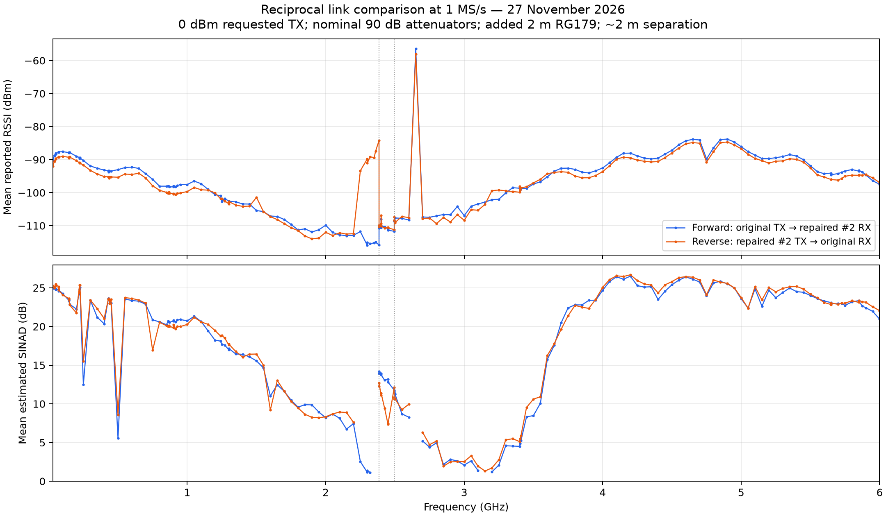
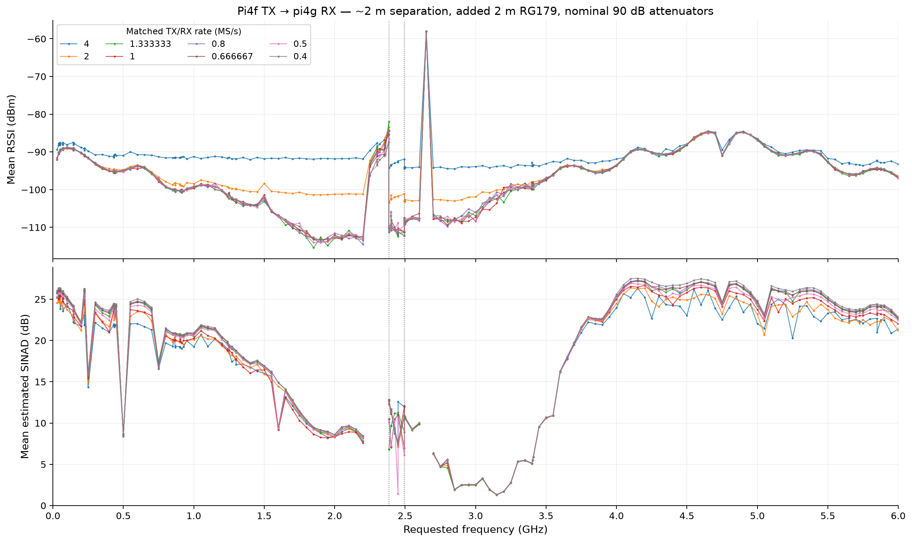
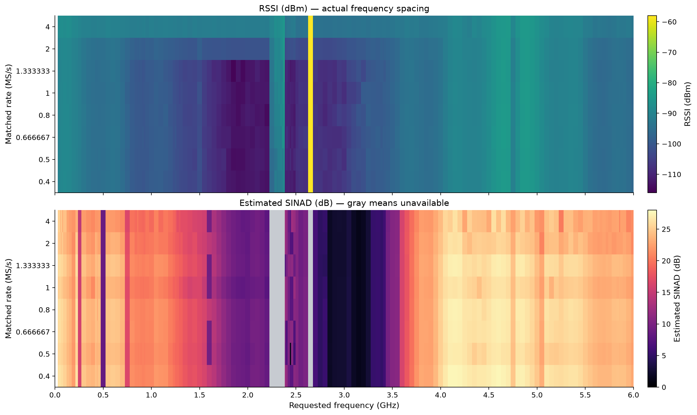
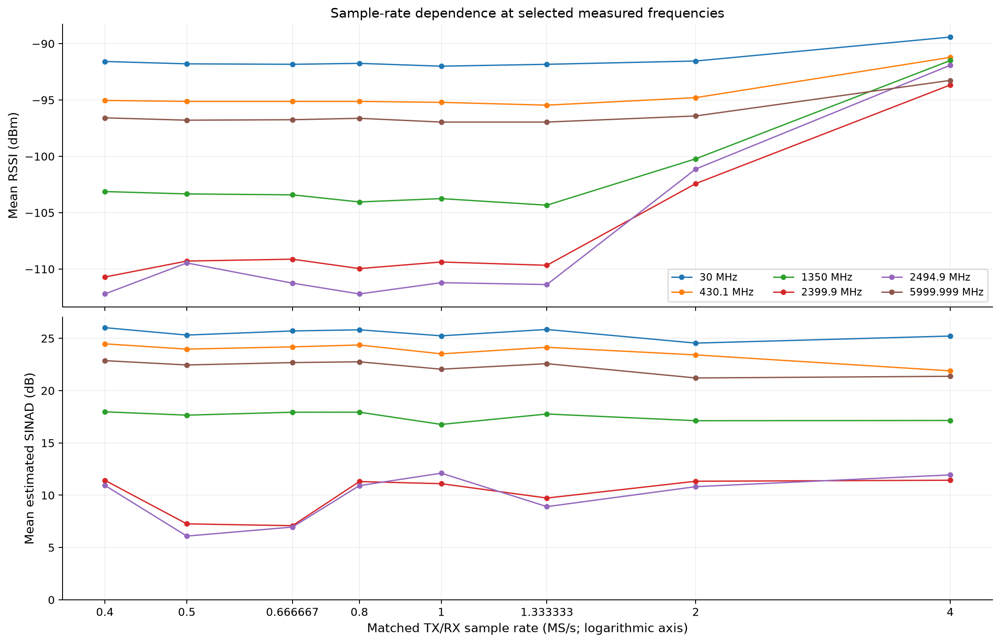
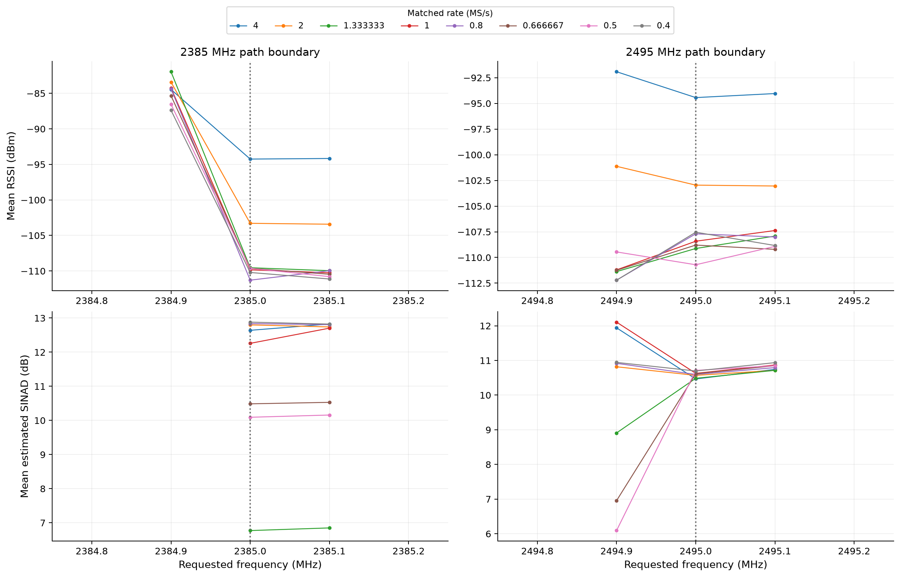

# Pi 4 reciprocal sweep with approximately two-metre separation

Repaired board #2 pi4f TX (192.168.6.163) to original pi4g RX (192.168.6.77).
Both hosts updated to GitHub dev-fpga-pa-control a997ec4 before this run.
Operator reports approximately 2 m separation, added 2 m RG179 and nominal 90 dB attenuators.
Added cable loss is additional and uncalibrated. These are complete TX/link/RX results.

Completed 1376 matrix points; independently verified 172 frequencies × eight matched rates.
Numeric SINAD: 1304/1376; transport-flagged windows: 0.

## Interpretation and acquisition reliability

The reverse run completed at 16:32 Europe/Brussels on 27 November 2026. All 1,376 matrix points and eight preflight points passed independent verification against 32,958 paired snapshots. Both radios were released. The receiver command audit found zero TX commands.

**Thirteen TX-start attempts failed** with `TX_PIPELINE_START`; every point recovered on its second attempt after both helper sessions were released and restarted. The sweep therefore ended as `complete_with_failures`, with no missing matrix points. All thirteen TX logs report `rc=-2`, `samples=0`, `writer_error=0` and `producer_error=0`. These are startup failures before retained measurement windows, not recorded in-window streaming errors. Their cause is not established by the sweep. The forward direction had no such setup failures. All retained reverse windows show no increases or resets in the selected transport counters.

Overall reciprocity is close: per-rate median paired SINAD differences are +0.03 to +0.33 dB (reverse minus forward), and median reported RSSI differences are -1.00 to -1.29 dB. This does not mean every frequency agrees or identify either board's isolated performance. The two directions swap both the transmitter and receiver, and the operator moved the headset while attempting to preserve the RF setup.

At 1 MS/s, forward versus reverse SINAD is 23.60 / 23.52 dB at 430.1 MHz, 20.73 / 20.27 dB at 1 GHz, 8.20 / 8.33 dB at 2 GHz, 26.12 / 26.37 dB at 4.65 GHz and 20.95 / 22.05 dB at 5999.999 MHz. The broad weak region around 2.2–3.4 GHz persists in both directions.

There is a pronounced reverse-direction RSSI rise near 2.25–2.385 GHz without numeric SINAD at the sampled points there; it cannot be interpreted as improved wanted-signal reception. The 2385 MHz <= f < 2495 MHz bypass region has a median paired SINAD difference of -2.86 dB across 64 fully valid pairs, with some larger individual differences. The approximately 2650 MHz high-RSSI/no-SINAD peak persists in both directions. These observations do not establish the cause of the interference or conversion artifacts.

Reverse SINAD is numeric at 1,304/1,376 points: 72 missing estimates, corresponding to all eight rates at 2250, 2300, 2300.1, 2320.1, 2350, 2360, 2384.9, 2400 and 2650 MHz. No reverse windows are partially valid. Forward had 48 missing and nine partially valid estimates. Missing SINAD is not zero or proof of no received RF. Reverse has 942 matrix points with numeric SINAD at least 12 dB, versus 978 forward; overall medians alone hide these missing and weak-frequency results.

## Comparison with the 27 November forward direction

Reference is pi4g TX to pi4f RX, measured earlier the same day with the same software, nominal attenuation and cable setup. The operator moved the headset and attempted to minimize disturbance. Differences are reverse minus forward; they combine both boards' TX/RX responses and the link, and cannot isolate either board or calibrated sensitivity. SINAD differences include only fully valid transport-clean pairs.

| Rate MS/s | Numeric SINAD | Median numeric SINAD dB | Median RSSI difference dB | Valid SINAD pairs | Median SINAD difference dB |
|---:|---:|---:|---:|---:|---:|
| 4 | 163 | 20.97 | -1.29 | 162 | 0.23 |
| 2 | 163 | 21.24 | -1.29 | 162 | 0.33 |
| 1.33333 | 163 | 22.50 | -1.25 | 162 | 0.09 |
| 1 | 163 | 21.74 | -1.09 | 162 | 0.17 |
| 0.8 | 163 | 22.56 | -1.08 | 162 | 0.07 |
| 0.666667 | 163 | 22.53 | -1.08 | 162 | 0.10 |
| 0.5 | 163 | 22.43 | -1.08 | 162 | 0.18 |
| 0.4 | 163 | 22.67 | -1.00 | 162 | 0.03 |

See REPORT.txt, verification.json, matrix-verification.json, results.csv and reference-comparison.csv for evidence.

## Frequency response

