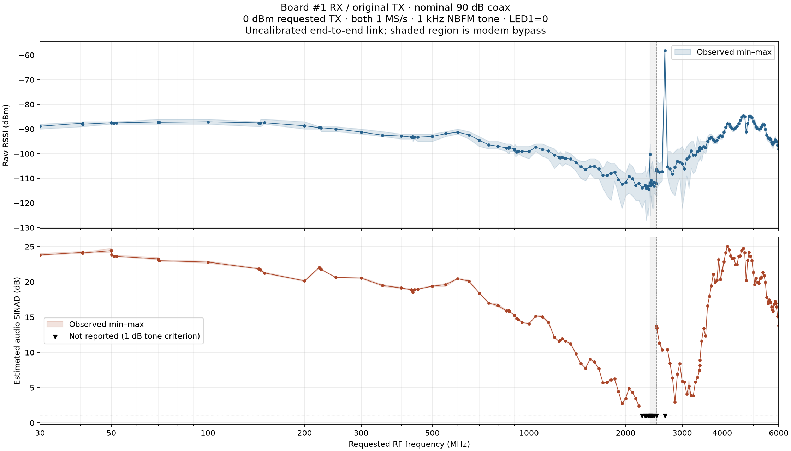
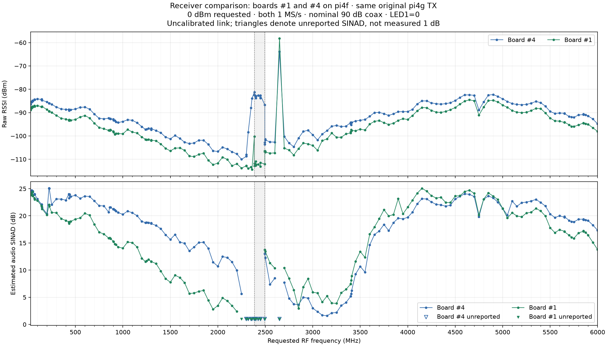
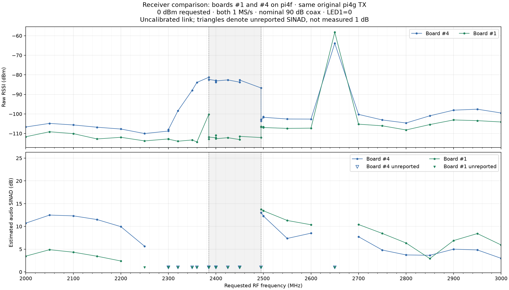

# Board #1 — 30 MHz to 6 GHz frequency sweep — 18 November 2026

Measured **172 of 172 planned frequencies**, retaining **4289 paired measurement snapshots**. **155 points** have fully valid SINAD estimates; **0 points** have nonzero cumulative transport counters; **0 measurement windows** have new transport errors. Independent verification reconciles all retained statistics and settings.

## Setup and scope

Original CaribouLite on pi4g-trixie transmits into board #1 on pi4f-trixie through the existing nominal **90 dB coax link**. Both use RF24 and **1 MS/s**. The transmitter requests **0 dBm** throughout (PA code 12), using the preceding NBFM test signal: 1 kHz tone, amplitude 0.4, deviation setting 2500 Hz. Actual calibrated RF output power was not measured.

Board #1 software **LED1=A39/LED4/D11 is explicitly held low** before every RX start, with readback and LED0 preservation. This matches board #4’s test conditions; no LED1-dependent failure is asserted for board #1. Neither FPGA firmware nor hardware was changed. Both receivers/transmitters retune while stopped; TX is stopped before RX retuning. Each point has 2 seconds settling and 5 seconds measurement.

The base grid is 50 MHz, supplemented with amateur/ISM band anchors, European SRD points, and additional samples around the modem-bypass boundaries at 2385 and 2495 MHz. The first point is 30 MHz. The upper software limit is exclusive: **the last point is 5,999.999 MHz; exactly 6,000 MHz was not measured**. This is a sampled sweep, not a continuous-frequency acceptance test.

Observed RX settings are 1 MS/s, 160 kHz analog bandwidth and 125 kHz digital cutoff. Observed TX settings are 1 MS/s, 80 kHz analog bandwidth and 125 kHz digital cutoff. Snapshot freshness is checked on each host independently; their monotonic clocks are not compared to each other.

The same 21 open-squelch follow-up frequencies used for board #4 were selected, together with any additional board #1 frequencies needing diagnostic follow-up. **21 selected points were repeated with both squelches disabled**, retaining the original runs and the per-point source selection. The final curves use the open-squelch repeats at those frequencies and the original open-gate data elsewhere. The estimator runs before the gate, so gate closure does not itself explain suppressed readings. It requires a detectable 1 kHz component using a 1 dB reporting criterion; unavailable readings are retained as unavailable, not assigned numeric values.

## Frequency response

[Linear-frequency plot](baselines/20261118-board1-frequency-sweep/frequency-linear.png) · [Vector logarithmic plot](baselines/20261118-board1-frequency-sweep/frequency-log.svg) · [All measurements CSV](baselines/20261118-board1-frequency-sweep/results.csv)

The highest point-mean estimated SINAD is **25.07 dB at 4150 MHz**; the lowest is **2.40 dB at 2200 MHz**. These extrema are measurements of the complete link, not isolated receiver sensitivity.

## Amateur and ISM coverage

Band labels use a Region 1 emphasis, with explicitly labeled Region 2 supplements for 222/915 MHz. National subbands vary. At least three measured frequencies fall in every listed range. European 863–870 MHz SRD coverage is included separately; it is not described as an ITU ISM allocation.

| Band | Range MHz | Measured / numeric SINAD points | Point-mean RSSI range dBm | Reported point-mean SINAD range dB |
|---|---:|---:|---:|---:|
| amateur-6m | 50–52 | 4 / 4 | -87.64 to -87.44 | 23.63 to 24.44 |
| amateur-4m | 70–70.5 | 3 / 3 | -87.36 to -87.08 | 23.01 to 23.27 |
| amateur-2m | 144–146 | 3 / 3 | -87.48 to -87.48 | 21.69 to 21.86 |
| amateur-1p25m | 222–225 | 3 / 3 | -89.48 to -89.40 | 21.79 to 22.04 |
| amateur-70cm | 430–440 | 6 / 6 | -93.36 to -93.12 | 18.57 to 18.88 |
| amateur-33cm | 902–928 | 3 / 3 | -99.32 to -98.44 | 14.68 to 15.25 |
| amateur-23cm | 1240–1300 | 5 / 5 | -101.96 to -101.48 | 11.56 to 11.96 |
| amateur-13cm | 2300–2450 | 14 / 0 | -114.33 to -100.28 | Unavailable |
| amateur-9cm | 3400–3410 | 4 / 4 | -98.71 to -97.36 | 7.44 to 8.90 |
| amateur-6cm | 5650–5850 | 8 / 8 | -96.00 to -94.08 | 15.85 to 17.25 |
| ISM-40MHz | 40.66–40.7 | 3 / 3 | -88.04 to -87.64 | 24.10 to 24.20 |
| ISM-433MHz | 433.05–434.79 | 3 / 3 | -93.28 to -93.12 | 18.57 to 18.81 |
| ISM-915MHz | 902–928 | 3 / 3 | -99.32 to -98.44 | 14.68 to 15.25 |
| ISM-2p4GHz | 2400–2500 | 10 / 4 | -113.12 to -106.44 | 13.43 to 13.75 |
| ISM-5p8GHz | 5725–5875 | 6 / 6 | -96.00 to -94.44 | 15.85 to 17.25 |

[Exact band membership and verification](baselines/20261118-board1-frequency-sweep/verification.json). Band-designation references: [ITU ISM frequencies](https://www.itu.int/net/ITU-R/terrestrial/faq/index.html), [RSGB amateur band plans](https://rsgb.services/public/bandplans/). These labels organize conducted laboratory measurements and do not state national operating permissions.

## Interpretation and limits

The curves include frequency-dependent TX/mixer output, receiver/mixer gain, coax and attenuator response, noise, distortion and clock/tone offsets. The 90 dB attenuation is nominal and was not calibrated across this range. The 0 dBm value is a requested/model setting, not a measured constant RF level at the coax connector. RSSI is the raw modem register reading; SINAD uses the existing fixed-notch audio estimator. No conclusion about calibrated receiver sensitivity, absolute frequency accuracy, board #1 TX performance, or the cause of board #4’s LED dependency follows from these data.

## Evidence and release

Run `cariboulite-board1-frequency-20261118T172514Z`. [Plan, collector/helper sources, summary, hashes and independent verification](baselines/20261118-board1-frequency-sweep/README.md). Full paired snapshots and both hosts’ status, command and backend logs are archived under `build/board1-frequency-sweep-20261118/`. The collector stops both radios on completion or exception. Final release checks are retained separately for both hosts; no receiver-side TX commands are part of the experiment.

## Direct comparison with board #4

[Logarithmic comparison](baselines/20261118-board1-frequency-sweep/comparison-log.png) · [Paired CSV](baselines/20261118-board1-frequency-sweep/comparison-board4.csv) · [Comparison summary](baselines/20261118-board1-frequency-sweep/comparison-summary.json)

All **172 frequencies** match exactly. Plan bytes, both hosts' backend/shared-library hashes, kernel versions, TX identity, tone, requested power/PA code and sample rates were verified. LED1 was low on both receivers. Wi-Fi/Bluetooth disable overlays and absence of exposed wireless devices were checked after the board #1 reboot; no wireless settings were changed.

Across matched frequencies, mean raw RSSI **board #1 minus board #4** is **-5.53 dB** (range -30.45 to +5.64). Across the **155 pairs with numeric SINAD on both boards**, mean SINAD difference is **-2.02 dB** (range -9.58 to +3.95). Missing estimates are excluded from this difference, not assigned zero.

SINAD is unreported on **both boards at 16 matched frequencies**, only on board #1 at **1**, and only on board #4 at **0**. Exact frequencies and the 2–3 GHz subset are recorded in the summary. These are time-separated, uncalibrated end-to-end comparisons; external RF conditions, connector power and attenuation versus frequency were not independently measured. Shared features alone do not distinguish the common TX, conversion paths, cable/attenuator response, receiver design or estimator.

## Receiver transport and final disposition

Full receiver status histories record **0 invalid-frame events** across the two board #1 runs. Selected measurement windows with new transport errors: **0**. Absolute and per-window counters remain in the data, and [event details](baselines/20261118-board1-frequency-sweep/transport-history.json) identify any startup observations. Final release checks cover both hosts. Board #1 remains on pi4f with LED1 low and the radios stopped.

## Matched frequencies of interest

| MHz | #1 RSSI dBm | #4 RSSI dBm | #1 SINAD dB | #4 SINAD dB |
|---:|---:|---:|---:|---:|
| 144.1 | -87.48 | -84.40 | 21.86 | 22.09 |
| 430.1 | -93.24 | -88.72 | 18.88 | 24.00 |
| 1240.1 | -101.48 | -97.28 | 11.56 | 18.75 |
| 2250 | -113.80 | -110.04 | Unreported | 5.64 |
| 2300.1 | -112.92 | -107.96 | Unreported | Unreported |
| 2385 | -112.92 | -82.48 | Unreported | Unreported |
| 2400.1 | -112.68 | -83.12 | Unreported | Unreported |
| 2450 | -111.48 | -82.68 | Unreported | Unreported |
| 2495 | -106.44 | -102.76 | 13.73 | 13.06 |
| 2650 | -58.24 | -63.88 | Unreported | Unreported |
| 3000 | -104.12 | -99.52 | 5.92 | 2.99 |
| 3405 | -97.36 | -95.28 | 8.15 | 5.66 |
| 5800 | -95.32 | -91.00 | 16.86 | 19.38 |
| 5999.999 | -98.08 | -94.83 | 13.79 | 17.34 |

The 2650 MHz RSSI peak and absence of a reported SINAD occur on both boards. The bypass-region RSSI levels differ substantially; shared SINAD suppression does not imply identical received spectra or identical causes. The tables and overlays retain these differences without treating the response as unique to one receiver.
