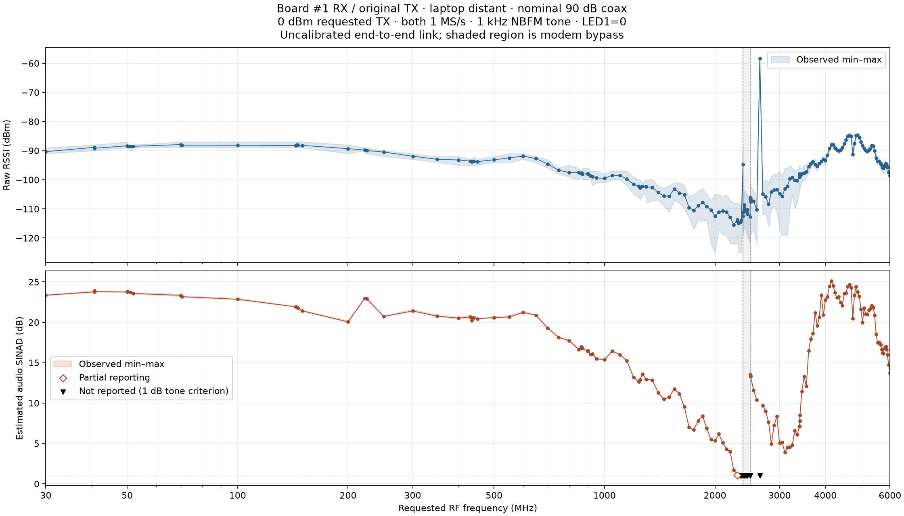
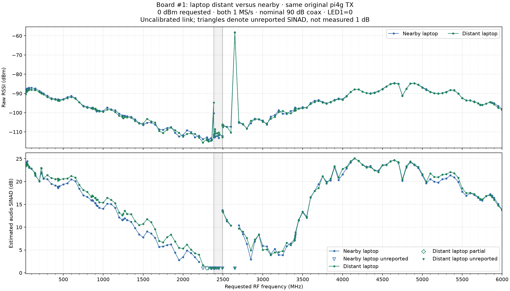
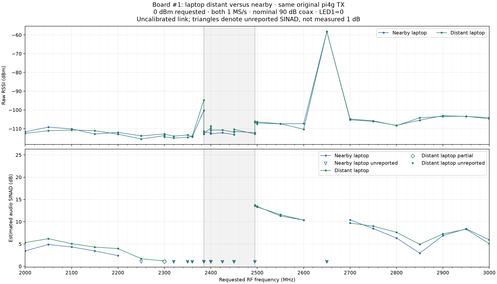

# Board #1 — laptop-distant frequency sweep — 18 November 2026

**The 2650 MHz peak persisted after moving the laptop away**, with no reported SINAD in either run. Distant-minus-nearby mean RSSI at that frequency is **−0.12 dB**. SINAD also remains unreported at the sampled bypass frequencies (`2385 ≤ f < 2495 MHz`).

Measured **172 of 172 planned frequencies**, retaining **4289 paired measurement snapshots**. **157 points** have fully valid SINAD estimates; **1** is partially reported and **14** are unreported; **118 points** have nonzero cumulative transport counters; **0 measurement windows** have new transport errors. Independent verification reconciles all retained statistics and settings.

## Setup and scope

Original CaribouLite on pi4g-trixie transmits into board #1 on pi4f-trixie through the existing nominal **90 dB coax link**. Both use RF24 and **1 MS/s**. The transmitter requests **0 dBm** throughout (PA code 12), using the preceding NBFM test signal: 1 kHz tone, amplitude 0.4, deviation setting 2500 Hz. Actual calibrated RF output power was not measured.

Board #1 software **LED1=A39/LED4/D11 is explicitly held low** before every RX start, with readback and LED0 preservation. This matches the earlier nearby-laptop board #1 test conditions. The user reports moving the laptop to a large distance; its distance was not measured. Neither FPGA firmware nor hardware was changed. Both receivers/transmitters retune while stopped; TX is stopped before RX retuning. Each point has 2 seconds settling and 5 seconds measurement.

The base grid is 50 MHz, supplemented with amateur/ISM band anchors, European SRD points, and additional samples around the modem-bypass boundaries at 2385 and 2495 MHz. The first point is 30 MHz. The upper software limit is exclusive: **the last point is 5,999.999 MHz; exactly 6,000 MHz was not measured**. This is a sampled sweep, not a continuous-frequency acceptance test.

Observed RX settings are 1 MS/s, 160 kHz analog bandwidth and 125 kHz digital cutoff. Observed TX settings are 1 MS/s, 80 kHz analog bandwidth and 125 kHz digital cutoff. Snapshot freshness is checked on each host independently; their monotonic clocks are not compared to each other.

The same 21 open-squelch follow-up frequencies used in the nearby-laptop board #1 run were selected, together with any additional frequencies needing diagnostic follow-up. **21 selected points were repeated with both squelches disabled**, retaining the original runs and the per-point source selection. The final curves use the open-squelch repeats at those frequencies and the original open-gate data elsewhere. The estimator runs before the gate, so gate closure does not itself explain suppressed readings. It requires a detectable 1 kHz component using a 1 dB reporting criterion; unavailable readings are retained as unavailable, not assigned numeric values.

## Frequency response

[Linear-frequency plot](baselines/20261118-board1-laptop-distant-frequency-sweep/frequency-linear.png) · [Vector logarithmic plot](baselines/20261118-board1-laptop-distant-frequency-sweep/frequency-log.svg) · [All measurements CSV](baselines/20261118-board1-laptop-distant-frequency-sweep/results.csv)

The highest point-mean estimated SINAD is **25.11 dB at 4150 MHz**; the lowest is **1.07 dB at 2300.1 MHz**. These extrema are measurements of the complete link, not isolated receiver sensitivity.

## Amateur and ISM coverage

Band labels use a Region 1 emphasis, with explicitly labeled Region 2 supplements for 222/915 MHz. National subbands vary. At least three measured frequencies fall in every listed range. European 863–870 MHz SRD coverage is included separately; it is not described as an ITU ISM allocation.

| Band | Range MHz | Measured / numeric SINAD points | Point-mean RSSI range dBm | Reported point-mean SINAD range dB |
|---|---:|---:|---:|---:|
| amateur-6m | 50–52 | 4 / 4 | -88.56 to -88.36 | 23.57 to 23.82 |
| amateur-4m | 70–70.5 | 3 / 3 | -88.16 to -87.92 | 23.17 to 23.34 |
| amateur-2m | 144–146 | 3 / 3 | -88.25 to -88.04 | 21.79 to 21.92 |
| amateur-1p25m | 222–225 | 3 / 3 | -89.96 to -89.80 | 22.93 to 22.98 |
| amateur-70cm | 430–440 | 6 / 6 | -93.76 to -93.60 | 20.24 to 20.65 |
| amateur-33cm | 902–928 | 3 / 3 | -98.84 to -97.92 | 16.01 to 16.46 |
| amateur-23cm | 1240–1300 | 5 / 5 | -102.84 to -102.20 | 12.62 to 13.59 |
| amateur-13cm | 2300–2450 | 14 / 2 | -114.96 to -94.72 | 1.07 to 1.19 |
| amateur-9cm | 3400–3410 | 4 / 4 | -99.04 to -98.00 | 7.10 to 8.49 |
| amateur-6cm | 5650–5850 | 8 / 8 | -96.04 to -94.32 | 16.11 to 17.26 |
| ISM-40MHz | 40.66–40.7 | 3 / 3 | -89.20 to -88.88 | 23.77 to 23.90 |
| ISM-433MHz | 433.05–434.79 | 3 / 3 | -93.76 to -93.60 | 20.24 to 20.59 |
| ISM-915MHz | 902–928 | 3 / 3 | -98.84 to -97.92 | 16.01 to 16.46 |
| ISM-2p4GHz | 2400–2500 | 10 / 4 | -112.80 to -106.04 | 13.31 to 13.55 |
| ISM-5p8GHz | 5725–5875 | 6 / 6 | -96.04 to -94.52 | 16.11 to 17.04 |

[Exact band membership and verification](baselines/20261118-board1-laptop-distant-frequency-sweep/verification.json). Band-designation references: [ITU ISM frequencies](https://www.itu.int/net/ITU-R/terrestrial/faq/index.html), [RSGB amateur band plans](https://rsgb.services/public/bandplans/). These labels organize conducted laboratory measurements and do not state national operating permissions.

## Interpretation and limits

The curves include frequency-dependent TX/mixer output, receiver/mixer gain, coax and attenuator response, noise, distortion and clock/tone offsets. The 90 dB attenuation is nominal and was not calibrated across this range. The 0 dBm value is a requested/model setting, not a measured constant RF level at the coax connector. RSSI is the raw modem register reading; SINAD uses the existing fixed-notch audio estimator. No conclusion about calibrated receiver sensitivity, absolute frequency accuracy, board #1 TX performance, or the cause of board #4’s LED dependency follows from these data.

## Evidence and release

Run `cariboulite-board1-distant-frequency-20261118T180227Z`. [Plan, collector/helper sources, summary, hashes and independent verification](baselines/20261118-board1-laptop-distant-frequency-sweep/README.md). Full paired snapshots and both hosts’ status, command and backend logs are archived under `build/board1-laptop-distant-frequency-sweep-20261118/`. The collector stops both radios on completion or exception. Final release checks are retained separately for both hosts; no receiver-side TX commands are part of the experiment.

## Transport qualifications

Nonzero transport counters occurred at 118 points. Their absolute and per-window changes are retained in summary.json. A stable inherited counter is distinguished from an event during measurement; these records are not a claim of an entirely error-free acquisition history.

## Laptop distant versus nearby

[Logarithmic overlay](baselines/20261118-board1-laptop-distant-frequency-sweep/comparison-log.png) · [Paired CSV](baselines/20261118-board1-laptop-distant-frequency-sweep/comparison-nearby.csv) · [Comparison summary](baselines/20261118-board1-laptop-distant-frequency-sweep/comparison-summary.json)

The same board #1 receiver and original TX were used at **172 identical frequencies**. Plan bytes, backend/shared-library hashes, kernel versions and backend arguments apart from socket paths match. The 21 original follow-up frequencies are included; additional distant-run follow-ups: 0. Laptop placement is user-reported, without a measured distance or independently measured emissions.

Mean raw RSSI **distant minus nearby** is **-0.21 dB** (range -3.00 to +5.56). For **155 pairs with numeric SINAD in both runs**, mean SINAD difference is **+0.59 dB** (range -0.88 to +2.95). Missing estimates are not assigned numeric values.

Unreported SINAD occurs at **14 frequencies in both runs**, **0 only with the laptop distant**, and **3 only with it nearby**. Exact frequencies and the 2–3 GHz subset are in the comparison summary.

Partially reported SINAD occurs at 1 distant-run frequencies and 0 nearby-run frequencies. Means at these frequencies use only reported estimator windows above its criterion; reporting fractions are retained in the CSV and should not be interpreted as fully restored reception.

## Selected paired measurements

| MHz | Distant RSSI dBm | Nearby RSSI dBm | Distant SINAD dB | Nearby SINAD dB |
|---:|---:|---:|---:|---:|
| 144.1 | -88.25 | -87.48 | 21.92 | 21.86 |
| 430.1 | -93.60 | -93.24 | 20.65 | 18.88 |
| 1240.1 | -102.20 | -101.48 | 12.62 | 11.56 |
| 2250 | -115.48 | -113.80 | 1.70 | Unreported |
| 2300.1 | -114.32 | -112.92 | 1.07 (partial) | Unreported |
| 2385 | -111.24 | -112.92 | Unreported | Unreported |
| 2400.1 | -110.72 | -112.68 | Unreported | Unreported |
| 2450 | -110.32 | -111.48 | Unreported | Unreported |
| 2495 | -106.72 | -106.44 | 13.54 | 13.73 |
| 2650 | -58.36 | -58.24 | Unreported | Unreported |
| 3000 | -104.72 | -104.12 | 5.04 | 5.92 |
| 3405 | -98.29 | -97.36 | 7.82 | 8.15 |
| 5800 | -95.32 | -95.32 | 16.82 | 16.86 |
| 5999.999 | -98.52 | -98.08 | 13.74 | 13.79 |

## Scope and final disposition

Full receiver histories record **3 invalid-frame events** in this distant-laptop experiment. Measurement windows with new transport errors: **0**. Both radios were stopped and released; board #1 remains on pi4f with LED1 low. The original nearby-laptop and board #4 measurements remain separate and unchanged.

These are time-separated, uncalibrated end-to-end measurements. Moving the laptop is the intended experimental change; laptop emissions, exact distance, other external RF sources, connector power, cable/attenuator response and thermal drift were not independently measured. Persistence or change of a feature in this comparison does not by itself identify its physical source.
