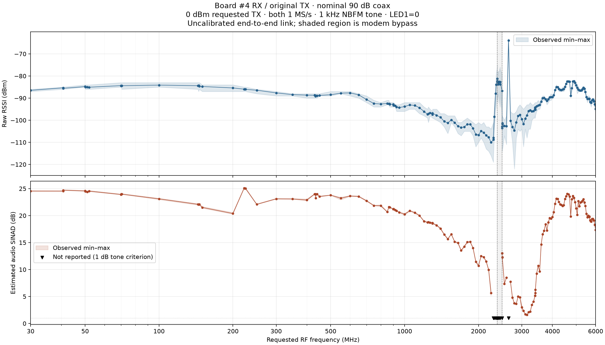

# Board #4 — 30 MHz to 6 GHz frequency sweep — 18 November 2026

Measured **172 of 172 planned frequencies**, retaining **4287 paired measurement snapshots**. **156 points** have fully valid SINAD estimates; **77 points** have nonzero cumulative transport counters; **0 measurement windows** have new transport errors. Independent verification reconciles all retained statistics and settings.

## Setup and scope

Original CaribouLite on pi4g-trixie transmits into board #4 on pi4f-trixie through the existing nominal **90 dB coax link**. Both use RF24 and **1 MS/s**. The transmitter requests **0 dBm** throughout (PA code 12), using the preceding NBFM test signal: 1 kHz tone, amplitude 0.4, deviation setting 2500 Hz. Actual calibrated RF output power was not measured.

Board #4 software **LED1=A39/LED4/D11 is explicitly held low** before every RX start, with readback and LED0 preservation. The unresolved LED1-high failure is not being retested. Neither FPGA firmware nor hardware was changed. Both receivers/transmitters retune while stopped; TX is stopped before RX retuning. Each point has 2 seconds settling and 5 seconds measurement.

The base grid is 50 MHz, supplemented with amateur/ISM band anchors, European SRD points, and additional samples around the modem-bypass boundaries at 2385 and 2495 MHz. The first point is 30 MHz. The upper software limit is exclusive: **the last point is 5,999.999 MHz; exactly 6,000 MHz was not measured**. This is a sampled sweep, not a continuous-frequency acceptance test.

Observed RX settings are 1 MS/s, 160 kHz analog bandwidth and 125 kHz digital cutoff. Observed TX settings are 1 MS/s, 80 kHz analog bandwidth and 125 kHz digital cutoff. Snapshot freshness is checked on each host independently; their monotonic clocks are not compared to each other.

Noise squelch closed the audio gate at some original points. **21 affected points were repeated with both squelches disabled**, retaining the original runs and the per-point source selection. The final curves use the open-squelch repeats at those frequencies and the original open-gate data elsewhere. The estimator runs before the gate, so gate closure does not itself explain suppressed readings. It requires a detectable 1 kHz component using a 1 dB reporting criterion; unavailable readings are retained as unavailable, not assigned numeric values.

## Frequency response

[Linear-frequency plot](baselines/20261118-board4-frequency-sweep/frequency-linear.png) · [Vector logarithmic plot](baselines/20261118-board4-frequency-sweep/frequency-log.svg) · [All measurements CSV](baselines/20261118-board4-frequency-sweep/results.csv)

The highest point-mean estimated SINAD is **25.10 dB at 222.1 MHz**; the lowest is **1.59 dB at 3150 MHz**. These extrema are measurements of the complete link, not isolated receiver sensitivity.

## Amateur and ISM coverage

Band labels use a Region 1 emphasis, with explicitly labeled Region 2 supplements for 222/915 MHz. National subbands vary. At least three measured frequencies fall in every listed range. European 863–870 MHz SRD coverage is included separately; it is not described as an ITU ISM allocation.

| Band | Range MHz | Measured / numeric SINAD points | Point-mean RSSI range dBm | Reported point-mean SINAD range dB |
|---|---:|---:|---:|---:|
| amateur-6m | 50–52 | 4 / 4 | -85.08 to -84.80 | 24.41 to 24.57 |
| amateur-4m | 70–70.5 | 3 / 3 | -84.52 to -84.36 | 23.91 to 23.98 |
| amateur-2m | 144–146 | 3 / 3 | -84.64 to -84.24 | 22.05 to 22.10 |
| amateur-1p25m | 222–225 | 3 / 3 | -86.04 to -85.96 | 25.04 to 25.10 |
| amateur-70cm | 430–440 | 6 / 6 | -89.12 to -88.72 | 23.26 to 24.00 |
| amateur-33cm | 902–928 | 3 / 3 | -94.00 to -93.32 | 20.88 to 21.25 |
| amateur-23cm | 1240–1300 | 5 / 5 | -97.40 to -96.72 | 18.57 to 18.77 |
| amateur-13cm | 2300–2450 | 14 / 0 | -108.76 to -81.28 | Unavailable |
| amateur-9cm | 3400–3410 | 4 / 4 | -95.28 to -94.20 | 5.17 to 6.25 |
| amateur-6cm | 5650–5850 | 8 / 8 | -92.04 to -90.28 | 18.88 to 19.85 |
| ISM-40MHz | 40.66–40.7 | 3 / 3 | -85.56 to -85.32 | 24.54 to 24.71 |
| ISM-433MHz | 433.05–434.79 | 3 / 3 | -89.12 to -88.88 | 23.26 to 23.97 |
| ISM-915MHz | 902–928 | 3 / 3 | -94.00 to -93.32 | 20.88 to 21.25 |
| ISM-2p4GHz | 2400–2500 | 10 / 4 | -103.56 to -82.60 | 12.27 to 13.06 |
| ISM-5p8GHz | 5725–5875 | 6 / 6 | -92.04 to -90.64 | 18.88 to 19.38 |

[Exact band membership and verification](baselines/20261118-board4-frequency-sweep/verification.json). Band-designation references: [ITU ISM frequencies](https://www.itu.int/net/ITU-R/terrestrial/faq/index.html), [RSGB amateur band plans](https://rsgb.services/public/bandplans/). These labels organize conducted laboratory measurements and do not state national operating permissions.

## Interpretation and limits

The curves include frequency-dependent TX/mixer output, receiver/mixer gain, coax and attenuator response, noise, distortion and clock/tone offsets. The 90 dB attenuation is nominal and was not calibrated across this range. The 0 dBm value is a requested/model setting, not a measured constant RF level at the coax connector. RSSI is the raw modem register reading; SINAD uses the existing fixed-notch audio estimator. No conclusion about calibrated receiver sensitivity, absolute frequency accuracy, board #4 TX performance, or the cause of the LED dependency follows from these data.

## Evidence and release

Run `cariboulite-board4-frequency-20261118T061904Z`. [Plan, collector/helper sources, summary, hashes and independent verification](baselines/20261118-board4-frequency-sweep/README.md). Full paired snapshots and both hosts’ status, command and backend logs are archived under `build/board4-frequency-sweep-20261118/`. The collector stops both radios on completion or exception. Final release checks are retained separately for both hosts; no receiver-side TX commands are part of the experiment.

## Transport qualifications

Nonzero transport counters occurred at 77 points. Their absolute and per-window changes are retained in summary.json. A stable inherited counter is distinguished from an event during measurement; these records are not a claim of an entirely error-free acquisition history.

## Observed startup framing events

Full receiver status histories record **three isolated invalid-frame events**:
one just after the 3.4099 GHz start in the main run, and one each just after
2.000 and 2.450 GHz starts in the open-squelch follow-up. All occurred before
the settled measurement windows. The cumulative counts persist into later
windows; no counter increased within any retained window. This is not a claim
that the complete startup/retuning history was error-free. See
[transport event history](baselines/20261118-board4-frequency-sweep/transport-history.json).

The **16 frequencies without reportable SINAD** are 2300, 2300.1, 2320.1,
2350, 2360, 2384.9, 2385, 2385.1, 2399.9, 2400, 2400.1, 2425, 2449.9,
2450, 2494.9 and 2650 MHz. All were measured and repeated; they are not gaps in
frequency coverage. In particular, the 13 cm range has RSSI measurements at
multiple points but no valid numeric SINAD estimates. The existing estimator
suppresses silence/non-finite data or results failing its 1 dB tone criterion;
that criterion prevents assigning an exact sub-threshold SINAD from status
alone. The plot's downward markers identify unreported values, not measured
1 dB values.
